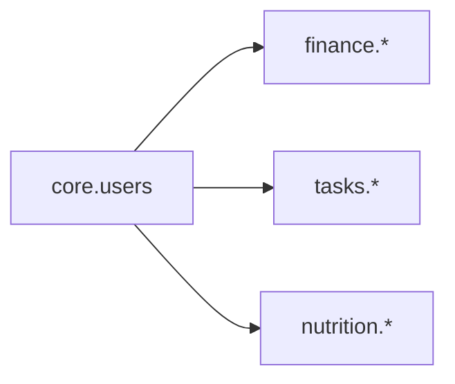

# Data Model Overview

*Status: the **`core` schema is implemented** (`db/migrations/20261025134012_core__init.sql`), and so is **`finance`** (`db/migrations/20261025150312_finance__init.sql`, then recurring transactions, approvals and the monthly checklist in `db/migrations/20261025155734_finance__recurring_and_checklist.sql`, and the deprecated `satisfies_checklist` columns dropped in `db/migrations/20261025170608_finance__drop_satisfies_checklist.sql`). `tasks` and `nutrition` are still **planning drafts** that their migrations will be written from. For the exact current schema, read the auto-generated `db/schema.sql`.*

This is the entry point for the Postgres data model. It covers how the model is split into modules, the conventions every table follows, and how the modules relate. Each module has its own doc with full table definitions.

```
docs/db/
├── db-overview.md     # You are here: modules, conventions, cross-module picture
├── shared.md          # Tables every module depends on (users, user_modules)
├── finance.md         # Budgets, categories, items, transactions, recurring bills
├── tasks.md           # Tasks (ad-hoc + maintenance) and their occurrences
└── nutrition.md       # Food catalog, food log, macro goals
```

---

## 1. Modules

Each module is a self-contained slice of the app and gets its **own Postgres schema**. That keeps `\dt` readable, mirrors the module folders in `api/app/modules/` and `web/src/modules/`, and maps cleanly onto a future Snowflake layout (one schema per module).

| Module | Postgres schema | Tables | Status | Doc |
|---|---|---|---|---|
| Shared | `core` | `users`, `user_modules` | Implemented | [shared.md](shared.md) |
| Finance | `finance` | `budgets`, `budget_categories`, `budget_items`, `transactions`, `transaction_allocations`, `recurring_transactions` | Implemented (two slices) | [finance.md](finance.md) |
| Tasks | `tasks` | `tasks`, `task_occurrences` | Planning draft | [tasks.md](tasks.md) |
| Nutrition | `nutrition` | `food_items`, `food_item_logs`, `macro_goals` | Planning draft | [nutrition.md](nutrition.md) |

**Module boundary rule:** the only foreign key that crosses a module boundary is `user_id → core.users.id`. Modules never reference each other's tables. Cross-module features (the morning and night reports, the "everything" dashboard) **read** from several modules through the API and don't need tables of their own.



---

## 2. Conventions (apply to every table)

These come straight from the design principles in `docs/project_plans/project-inspiration.md` §4.

### Columns every table has

| Column | Type | Notes |
|---|---|---|
| `id` | `uuid` PK | Default `uuidv7()` (native in Postgres 18, which we run locally and on RDS). Time-ordered, so indexes stay compact. |
| `user_id` | `uuid` NOT NULL → `core.users.id` | On every user-owned table, **even child tables** (like `budget_items`), so row-level security never needs a join. Not on `core.users` itself. |
| `created_at` | `timestamptz` NOT NULL default `now()` | |
| `updated_at` | `timestamptz` NOT NULL default `now()` | Maintained by the shared `core.set_updated_at()` trigger function. **Every table** gets `CREATE TRIGGER set_updated_at BEFORE UPDATE ... FOR EACH ROW EXECUTE FUNCTION core.set_updated_at()`. |
| `deleted_at` | `timestamptz` NULL | Soft delete. App queries filter `deleted_at IS NULL`. |

### Naming
- `snake_case`, **plural** table names, singular column names.
- FKs are `<singular_table>_id` (e.g. `budget_item_id`).
- Booleans start with `is_` / `has_`. Timestamps end in `_at`, dates end in `_on`.

### Types
- **Money:** `numeric(12,2)`, always **positive**. Direction comes from a `kind` column (`'income'` / `'expense'`), never from a negative sign. USD only in v1.
- **Enumerations:** `text` + `CHECK (col IN (...))` rather than Postgres `ENUM` types, because CHECK constraints are much easier to change in a migration.
- **Recurrence:** decided per module, preferring the simplest form that covers the real cases. Finance's recurring transactions use **explicit schedule columns** (`frequency`, `day_of_week`, `day_of_month`, `starts_on`, `ends_on`; see [finance.md](finance.md)) rather than RRULE strings: easy to CHECK and to edit in a form, with no parser. The tasks draft still plans RRULE strings ([tasks.md](tasks.md)); revisit when it's built.
- **Dates vs. times:** "which day does this belong to" is stored as a `date` resolved in the **user's timezone** (`core.users.timezone`) at write time. Exact moments are `timestamptz`.

### Integrity
- **Unique constraints are partial indexes** with `WHERE deleted_at IS NULL`, so a soft-deleted row doesn't block re-creating something with the same name.
- **Row-level security** on every user-owned table (see below).
- **Tenant guard: composite foreign keys.** RLS limits what a user can see, but **FK checks bypass RLS**, so a plain `FOREIGN KEY (budget_id) REFERENCES budgets (id)` would let a user who guessed another user's id link to it. Every parent table a user-owned child points at gets a unique `(id, user_id)`, and **every child FK includes `user_id`**: `FOREIGN KEY (budget_id, user_id) REFERENCES finance.budgets (id, user_id)`. Together with RLS's `WITH CHECK`, a row can only reference parents owned by the same user. Extra columns can join the key when they must match too (finance's `(category_id, kind, user_id)` also forces an item's category to be of the item's kind). A nullable FK uses the default `MATCH SIMPLE`, so NULL skips the check. Applies to all modules; see [finance.md](finance.md) §3.1 for the first use.
- **Soft deletes everywhere, with narrow exceptions.** Pure link rows that are replaced rather than edited and carry no history may be hard-deleted and skip `deleted_at` (currently only `finance.transaction_allocations`). Each exception is called out in its module doc.
- **Derived numbers aren't stored as the only record.** Totals (budget actuals, daily macros, task completion counts) are computed by queries or views from the raw rows.

### Row-level security & privileges
- The API connects as (a login user that is a member of) the role **`disci_app`**; locally that login is `disci_api` (`db/local/roles.sql`). It is **not** the table owner, so RLS applies to it. Migrations run as the owner.
- At the start of each transaction the API runs `SET LOCAL app.user_id = '<uuid>'`. **`core.current_user_id()`** reads that setting and returns NULL when it's unset, so a request that forgot to set it sees no rows.
- Every user-owned table runs `ALTER TABLE ... ENABLE ROW LEVEL SECURITY` and gets a policy of the form:
  ```sql
  CREATE POLICY <table>_owner ON <schema>.<table> TO disci_app
      USING (user_id = core.current_user_id())
      WITH CHECK (user_id = core.current_user_id());
  ```
- **`SECURITY DEFINER` functions are the only way around RLS for `disci_app`, and are kept narrow.** Two patterns exist:
  - **Bootstrap before the user is known:** `core.ensure_user(sub, email)` runs before `app.user_id` can be set (see [shared.md](shared.md)).
  - **Narrow cross-user lookups for scheduled jobs:** e.g. `finance.users_with_recurring()` returns only `(user_id, timezone)` for users with active recurring rules. The job then sets `app.user_id` and works **one user at a time under RLS**, exactly like an API request.

  Each one sets `search_path` explicitly (`SET search_path = pg_catalog, ...`), returns the minimum it needs to, `REVOKE`s `EXECUTE` from `PUBLIC` and grants it only to `disci_app`.
- **Grants come from default privileges per schema.** Each module's first migration (the one that creates its schema) must `GRANT USAGE ON SCHEMA <module> TO disci_app` and `ALTER DEFAULT PRIVILEGES IN SCHEMA <module> GRANT SELECT, INSERT, UPDATE, DELETE ON TABLES TO disci_app`. Tables created later in that schema then need no per-table grants.

### Seeded defaults
Some lookup tables (currently just `budget_categories`) ship with defaults. Defaults are **copied into each user's own rows when they first enable the module** (see `core.user_modules`) (flagged `is_default = true`) instead of living as shared global rows. The user can then rename, recolor or delete them freely, and RLS stays simple.

---

## 3. Open questions (cross-cutting)

Module-specific questions live at the bottom of each module doc.

1. ~~Postgres version on RDS~~. Decided: Postgres 18 (native `uuidv7()`).
2. ~~Week start day~~. Decided: a per-user setting, `core.users.week_starts_on` (default Monday).
