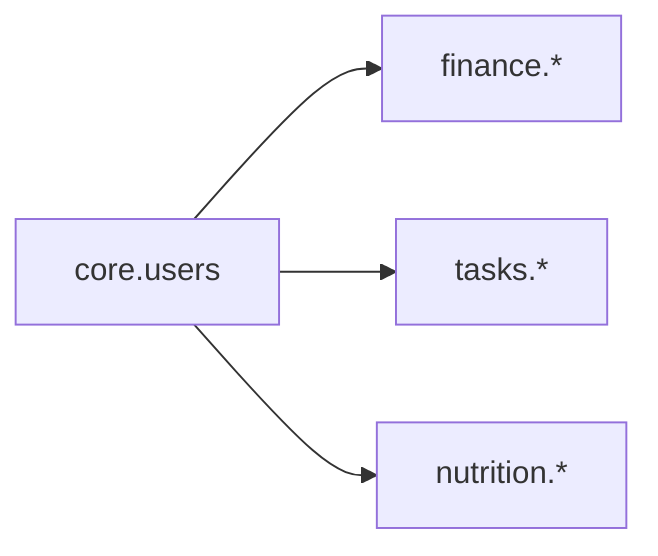

# Data Model Overview

*Status: **planning draft**. No migrations exist yet. These docs are the design that the first migrations will be written from.*

This is the entry point for the Postgres data model. It covers how the model is split into modules, the conventions every table follows, and how the modules relate. Each module has its own doc with full table definitions.

```
docs/db/
├── db-overview.md     # You are here: modules, conventions, cross-module picture
├── shared.md          # Tables every module depends on (users, user_modules)
├── finance.md         # Budgets, categories, items, transactions, recurring bills
├── tasks.md           # Tasks (ad-hoc + maintenance) and their occurrences
└── nutrition.md       # Food catalog, food log, macro goals
```

---

## 1. Modules

Each module is a self-contained slice of the app and gets its **own Postgres schema**. That keeps `\dt` readable, mirrors the module folders in `api/app/modules/` and `web/src/modules/`, and maps cleanly onto a future Snowflake layout (one schema per module).

| Module | Postgres schema | Tables | Doc |
|---|---|---|---|
| Shared | `core` | `users`, `user_modules` | [shared.md](shared.md) |
| Finance | `finance` | `budgets`, `budget_categories`, `budget_items`, `transactions`, `transaction_allocations`, `recurring_transactions` | [finance.md](finance.md) |
| Tasks | `tasks` | `tasks`, `task_occurrences` | [tasks.md](tasks.md) |
| Nutrition | `nutrition` | `food_items`, `food_item_logs`, `macro_goals` | [nutrition.md](nutrition.md) |

**Module boundary rule:** the only foreign key that crosses a module boundary is `user_id → core.users.id`. Modules never reference each other's tables. Cross-module features (the morning and night reports, the "everything" dashboard) **read** from several modules through the API and don't need tables of their own.



---

## 2. Conventions (apply to every table)

These come straight from the design principles in `docs/project_plans/project-inspiration.md` §4.

### Columns every table has

| Column | Type | Notes |
|---|---|---|
| `id` | `uuid` PK | Default `gen_random_uuid()`. Switch to `uuidv7()` if we land on Postgres 18+ (time-ordered, nicer indexes). |
| `user_id` | `uuid` NOT NULL → `core.users.id` | On every user-owned table, **even child tables** (like `budget_items`), so row-level security never needs a join. Not on `core.users` itself. |
| `created_at` | `timestamptz` NOT NULL default `now()` | |
| `updated_at` | `timestamptz` NOT NULL default `now()` | Maintained by a shared trigger. |
| `deleted_at` | `timestamptz` NULL | Soft delete. App queries filter `deleted_at IS NULL`. |

### Naming
- `snake_case`, **plural** table names, singular column names.
- FKs are `<singular_table>_id` (e.g. `budget_item_id`).
- Booleans start with `is_` / `has_`. Timestamps end in `_at`, dates end in `_on`.

### Types
- **Money:** `numeric(12,2)`, always **positive**. Direction comes from a `kind` column (`'income'` / `'expense'`), never from a negative sign. USD only in v1.
- **Enumerations:** `text` + `CHECK (col IN (...))` rather than Postgres `ENUM` types, because CHECK constraints are much easier to change in a migration.
- **Recurrence:** iCal **RRULE** strings (e.g. `FREQ=DAILY`, `FREQ=WEEKLY;INTERVAL=2`) wherever something repeats (recurring bills and recurring tasks), so there's one parser and one mental model.
- **Dates vs. times:** "which day does this belong to" is stored as a `date` resolved in the **user's timezone** (`core.users.timezone`) at write time. Exact moments are `timestamptz`.

### Integrity
- **Unique constraints are partial indexes** with `WHERE deleted_at IS NULL`, so a soft-deleted row doesn't block re-creating something with the same name.
- **Row-level security** on every user-owned table. The API sets `app.user_id` per request, and policies check `user_id = current_setting('app.user_id')::uuid`.
- **Derived numbers aren't stored as the only record.** Totals (budget actuals, daily macros, task completion counts) are computed by queries or views from the raw rows.

### Seeded defaults
Some lookup tables (currently just `budget_categories`) ship with defaults. Defaults are **copied into each user's own rows when they first enable the module** (see `core.user_modules`) (flagged `is_default = true`) instead of living as shared global rows. The user can then rename, recolor or delete them freely, and RLS stays simple.

---

## 3. Open questions (cross-cutting)

Module-specific questions live at the bottom of each module doc.

1. **Postgres version on RDS:** 18+ gets native `uuidv7()`.
2. **Week start day** for weekly budgets and "this week" views: Monday or Sunday? This could be a per-user setting on `core.users`.
