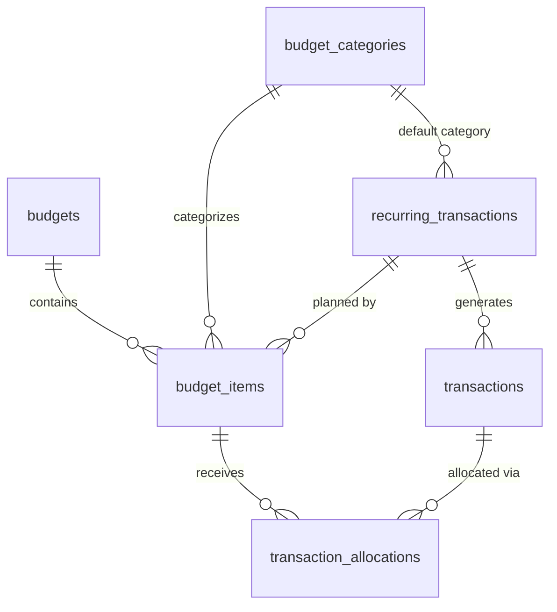

# Finance Module (`finance` schema)

*Status: **first slice implemented** in `db/migrations/20261025150312_finance__init.sql` (`budget_categories`, `budgets`, `budget_items`, `transactions`, `transaction_allocations`), plus a one-time default-category backfill in `db/migrations/20261025153025_finance__backfill_default_categories.sql` (see the seed list under `budget_categories`); **recurring transactions are still planned** (a later migration). Columns not built yet are marked **(planned)** below. See [db-overview.md](db-overview.md) for conventions (audit columns, soft deletes, RLS, money types) that apply to every table below. The API is in [api-overview.md](../api/api-overview.md) §7 and the screens in [finance-ui.md](../ui/finance-ui.md).*

**Replaces:** EveryDollar (budget plus every logged expense) **and** the Google Sheet bills checklist.

---

## 1. What the module does

From the brainstorm notes, plus functionality inferred from them and from the project inspiration doc (inferred items are marked ✱):

- **Create a budget for a period**: a week, a month or a year. A budget is just a container, and a period can have **more than one budget** (e.g. "October 2026" and "October – Vacation").
- **Plan line items** inside a budget ("Uber Eats: $120", "Paycheck: $3,000"). Each item is an expected **expense or income**, and can **optionally** be put in a **category**. Items without one show as **Uncategorized**.
- **Categories** are typed too: each belongs under **Expenses** or **Incomes**, and only items of the same type can use it. Expense categories come pre-made; users can add, rename and archive their own of either type.

How a budget reads:

```
Incomes
├── <custom income category>
│   └── Paycheck
└── Uncategorized
    └── Side gig

Expenses
├── Housing
│   └── Rent
├── Food
│   ├── Groceries
│   └── Uber Eats
├── <custom expense category>
│   └── ...
└── Uncategorized
    └── Birthday gift
```
- **Log actual transactions** (income or expense) and assign them to budget items. One transaction can count toward **more than one budget**, e.g. the October monthly budget *and* the 2026 annual budget.
- **The user always picks exactly which budget(s) a transaction applies to.** Nothing is added to a budget automatically based on its date. In practice you usually add a transaction *from a budget's page*, so the "apply to budget" field is pre-filled with that budget, and others can be added. *(The detailed UI is to be designed later.)*
- ✱ **Split a transaction** across items (one Target run: $40 groceries + $25 household). This uses the same mechanism as the multi-budget case.
- **Recurring transactions** (subscriptions, rent, bills) are stored as rules and **auto-logged** on schedule.
- **Auto-logged transactions need user verification**: they start as *pending*, and the user confirms them (adjusting the amount if, say, the electric bill came in different).
- ✱ **Bills checklist view**: this month's recurring transactions with pending/confirmed status *is* the old bills sheet. Confirming a bill *is* logging the expense, so the double-log goes away (inspiration doc principle #2).
- ✱ **Budget vs. actual** per item, per category and per budget.
- ✱ **"Needs assignment" inbox**: confirmed transactions that aren't allocated to any budget item yet.
- ✱ **Copy a budget** to start a new one. **Built** as an option on budget creation (`copy_from_budget_id` on `POST /finance/budgets`): the source must be the user's own budget of the same period type. Items carry over (kind, category, name, planned amount, sort order, notes; items whose category was deleted come across Uncategorized); transactions and allocations do not. Recurring links will carry over once recurring transactions exist. No extra table.
- ✱ **Fast entry helpers** (recent payees, last-used item for a payee), which come from querying `transactions` and need no extra table.

---

## 2. Entity diagram



(Every table also has `user_id → core.users`, omitted for readability.)

### Changes from the brainstorm notes
- **Added `transaction_allocations`** (junction between `transactions` and `budget_items`). The notes say a transaction can be tied to multiple budgets, which needs a many-to-many link. Linking to the **budget item** rather than the budget itself is what makes item-level budget vs. actual possible, and it gives transaction splitting for free.
- **Transactions have no `category_id`.** The category comes from the budget item a transaction is allocated to, which avoids two sources of truth disagreeing. Unallocated transactions show up in the "needs assignment" inbox.
- **Categories are optional and typed.** `budget_items.category_id` is nullable (NULL = Uncategorized; there is no "Uncategorized" row), and every category has a `kind`. A composite foreign key makes the database reject an expense item in an income category.
- **No category groups.** An earlier idea of group/subgroup levels was dropped: the expense/income type is the top level, and categories sit directly under it.
- **The "approved" flag lives on each generated transaction** (`status = pending | confirmed`), not only on the recurring rule. The rule gets an `is_auto_confirmed` option for things you never want to verify by hand.

---

## 3. Tables

### `budgets`
A container for one period.

| Column | Type | Null | Notes |
|---|---|---|---|
| `id`, `user_id` | `uuid` | no | |
| `name` | `text` | no | Defaults to something like "October 2026", but the user can edit it. Tells apart budgets that share a period. |
| `period_type` | `text` | no | `CHECK IN ('week','month','year')` |
| `period_start` | `date` | no | 1st of the month / Jan 1 / the user's week-start day. |
| `period_end` | `date` | no | Inclusive. Set by the API from type and start; stored to keep range queries simple. |
| `notes` | `text` | yes | |

- **No uniqueness on the period:** several budgets can cover the same month (e.g. a regular one and a vacation one).
- `CHECK (period_end >= period_start)`.
- **Effective date range:** `period_start`..`period_end`, inclusive. A budget is **active** when today, in the user's timezone (`core.users.timezone`), falls within it; computed in the web app (no column). Overlapping budgets (a monthly and a yearly one, or two for the same month) can all be active at once.
- Unique `(id, user_id)`: target of `budget_items`' composite FK (§3.1).
- The API derives `period_start` / `period_end` from `period_type` plus any date in the period (weeks use `core.users.week_starts_on`) and defaults `name` to "October 2026", "2026" or "Week of Oct 19, 2026".

### `budget_categories`
Optional buckets for budget items, each under Expenses or Incomes.

| Column | Type | Null | Notes |
|---|---|---|---|
| `id`, `user_id` | `uuid` | no | |
| `kind` | `text` | no | `CHECK IN ('expense','income')`. Which side of the budget the category lives on. |
| `name` | `text` | no | Unique per user **and kind** (case-insensitive). |
| `color` | `text` | yes | Hex, for charts. |
| `icon` | `text` | yes | |
| `sort_order` | `integer` | no | Default `0`. |
| `is_default` | `boolean` | no | True if copied from the seed list when the module was first enabled. |

- Unique `(id, kind, user_id)`: redundant with the PK, but it's the target of the composite foreign keys that keep item and category types (and owners) consistent (see `budget_items` and §3.1).
- Name uniqueness is a partial unique index on `(user_id, kind, lower(name)) WHERE deleted_at IS NULL`; the API returns **409** on a duplicate.

**Seed list** (expense categories, copied in by the module's `setup` the first time a user turns on Finance): Housing, Insurance, Utilities, Transportation, Debts, Savings, Food, Personal, Health. **No default income categories**; users create their own.

**Backfill:** `db/migrations/20261025153025_finance__backfill_default_categories.sql` is a one-time data migration for users who turned Finance on before the module existed and so never ran its first-enable `setup`. It gives the seed list to users who have Finance enabled and **no** category rows at all (deleted or not), so it never re-adds categories someone deleted on purpose. The default list now lives in two places: `DEFAULT_EXPENSE_CATEGORIES` in `api/app/modules/finance/service.py` and this migration. The migration's copy is frozen history; future changes to the defaults only change `service.py`.

### `budget_items`
A planned line in a specific budget.

| Column | Type | Null | Notes |
|---|---|---|---|
| `id`, `user_id` | `uuid` | no | |
| `budget_id` | `uuid` | no | → `budgets` |
| `kind` | `text` | no | `CHECK IN ('expense','income')` |
| `category_id` | `uuid` | yes | → `budget_categories`. **NULL = Uncategorized.** |
| `name` | `text` | no | Free text, e.g. "Uber Eats". |
| `planned_amount` | `numeric(12,2)` | no | `>= 0` |
| `recurring_transaction_id` | `uuid` | yes | **(planned)** → `recurring_transactions`. Set when the item exists to plan for a recurring bill or paycheck, which lets auto-logged transactions find their item. |
| `sort_order` | `integer` | no | Default `0`. |
| `notes` | `text` | yes | |

- `FOREIGN KEY (category_id, kind, user_id) REFERENCES budget_categories (id, kind, user_id)`: an item can only use a category of its own type (and its own user's). With `category_id` NULL the check is skipped (standard `MATCH SIMPLE`), which is exactly "Uncategorized".
- `FOREIGN KEY (budget_id, user_id) REFERENCES budgets (id, user_id)`; unique `(id, user_id)` as the target for allocations.
- **(planned)** Unique `(budget_id, recurring_transaction_id)` where not null, so a recurring rule maps to at most one item per budget.

### `transactions`
Money that actually moved (or, while `pending`, is expected to).

**Built so far:** `id`, `user_id`, `kind`, `amount`, `occurred_on`, `payee`, `description`, `notes` (plus audit columns), and unique `(id, user_id)`. The four recurring/status columns are **(planned)** and arrive with recurring transactions; until then every transaction is effectively confirmed.

| Column | Type | Null | Notes |
|---|---|---|---|
| `id`, `user_id` | `uuid` | no | |
| `kind` | `text` | no | `CHECK IN ('expense','income')` |
| `amount` | `numeric(12,2)` | no | `> 0` |
| `occurred_on` | `date` | no | Day it happened, in the user's timezone. |
| `payee` | `text` | yes | Merchant or income source ("Kroger", "Employer"). Drives "recent payees" autocomplete. |
| `description` | `text` | yes | |
| `status` | `text` | no | **(planned)** `CHECK IN ('pending','confirmed')`, default `'confirmed'`. Manually logged transactions are confirmed right away. |
| `confirmed_at` | `timestamptz` | yes | **(planned)** When the user verified it (or when it was created, for manual entries). |
| `recurring_transaction_id` | `uuid` | yes | **(planned)** → `recurring_transactions`. Set if generated from a rule. |
| `scheduled_on` | `date` | yes | **(planned)** For generated rows: the occurrence date the rule produced. Stays fixed even if the user edits `occurred_on`. |
| `notes` | `text` | yes | |

- **(planned)** Unique `(recurring_transaction_id, scheduled_on)` where not null, which makes the generator job idempotent.
- **(planned)** **Actuals only count `confirmed` transactions.** Pending ones show up as "expected" or "projected". (Today there is no status, so every non-deleted transaction counts.)

### `transaction_allocations`
Links a transaction to the budget item(s) it counts toward.

| Column | Type | Null | Notes |
|---|---|---|---|
| `id`, `user_id` | `uuid` | no | |
| `transaction_id` | `uuid` | no | → `transactions` |
| `budget_item_id` | `uuid` | no | → `budget_items` |
| `amount` | `numeric(12,2)` | no | `> 0`. The portion of the transaction counted toward this item. |

- Unique `(transaction_id, budget_item_id)`.
- FKs `(transaction_id, user_id) → transactions (id, user_id)` and `(budget_item_id, user_id) → budget_items (id, user_id)` (see §3.1).
- **Hard-deleted, no `deleted_at`.** An exception to the soft-delete convention: allocations are replaced rather than edited and carry no history of their own, so they are deleted outright (they still have `created_at` / `updated_at`).
- **A transaction of either kind can be allocated to an item of either kind.** An income transaction on an expense item is a **credit** against it (a grocery rebate or a return reduces what Groceries actually cost), and an expense on an income item reduces what it brought in. See "Budget vs. actual" in §4 for the netting.
- **Rule enforced by the API** (it spans rows, so it can't be a simple CHECK): within any **one** budget, a transaction's allocations sum to at most its `amount`. Across different budgets the same dollars can count again, which is the point.
- **The date isn't enforced.** A transaction dated outside a budget's period can still be allocated to it (e.g. November rent paid on Oct 30 goes in the November budget). The UI may show a soft warning.
- **Allocations are only ever created by an explicit user choice.** No allocation is inferred from dates or categories.
- **Common case:** one allocation, for the full amount, to an item in the budget whose page you're on. The UI and MCP just ask "which item?" and the API writes the row(s).

### `recurring_transactions`
*(planned: not in the first migration.)*

A rule for money that moves on a schedule: subscriptions, rent, utilities, paychecks.

| Column | Type | Null | Notes |
|---|---|---|---|
| `id`, `user_id` | `uuid` | no | |
| `name` | `text` | no | "Netflix", "Rent". |
| `kind` | `text` | no | `CHECK IN ('expense','income')` |
| `amount` | `numeric(12,2)` | no | Expected amount. |
| `is_amount_variable` | `boolean` | no | Default `false`. True for things like utilities, where the UI prompts for the real amount when confirming. |
| `category_id` | `uuid` | yes | → `budget_categories` (same composite `(category_id, kind)` key as budget items). Used when creating budget items for this rule; NULL = Uncategorized. |
| `payee` | `text` | yes | Copied onto generated transactions. |
| `recurrence_rule` | `text` | no | RRULE, e.g. `FREQ=MONTHLY;BYMONTHDAY=15`. |
| `starts_on` | `date` | no | |
| `ends_on` | `date` | yes | For subscriptions that end, or loans paid off. |
| `is_autopay` | `boolean` | no | Default `false`. Informational ("the bank pays this automatically"), shown on the checklist. |
| `is_auto_confirmed` | `boolean` | no | Default `false`. If true, generated transactions are created as `confirmed` and skip verification. |
| `paused_at` | `timestamptz` | yes | Paused rules generate nothing. |
| `notes` | `text` | yes | |

### 3.1 Tenant guard: composite foreign keys

RLS limits what a user can **see**, but foreign-key checks bypass RLS. Without a guard, a user who guessed another user's row id could point a row at it (e.g. allocate their transaction to someone else's budget item). So every parent table has a unique `(id, user_id)` (categories: `(id, kind, user_id)`), and **every child FK includes `user_id`**:

| Child | Foreign key |
|---|---|
| `budget_items` | `(budget_id, user_id) → budgets (id, user_id)` |
| `budget_items` | `(category_id, kind, user_id) → budget_categories (id, kind, user_id)`, `MATCH SIMPLE`, so NULL = Uncategorized skips it |
| `transaction_allocations` | `(transaction_id, user_id) → transactions (id, user_id)` |
| `transaction_allocations` | `(budget_item_id, user_id) → budget_items (id, user_id)` |

Combined with RLS's `WITH CHECK (user_id = core.current_user_id())`, a row can only reference parents owned by the same user. This is a convention for every module (see [db-overview.md](db-overview.md) §2, Integrity).

### 3.2 Delete behavior

| Deleting | What happens |
|---|---|
| A category | Soft-deleted; its items' `category_id` is set to NULL (they become Uncategorized). |
| A budget item | Soft-deleted; its allocations are hard-deleted, so those transactions become unassigned. |
| A budget | Soft-deleted along with its items; their allocations are hard-deleted (transactions become unassigned). |
| A transaction | Soft-deleted; its allocations are hard-deleted. |

### 3.3 Dev seed

`db/seeds/dev.sql` gives the local dev user the default expense categories, a custom income category "Salary", and a budget for the current month with sample items and transactions (including a $25 grocery rebate, an income transaction credited against Groceries). It only creates the budget if none exists for that month.

---

## 4. How the features map to the tables

| Feature | How |
|---|---|
| **Auto-logging** *(planned)* | A scheduled job (EventBridge, daily) expands each active rule's RRULE and inserts `pending` transactions for occurrences in the current month, using `scheduled_on` for idempotency. Generated transactions start with **no allocations**. |
| **Bills checklist** *(planned)* | `transactions WHERE recurring_transaction_id IS NOT NULL AND scheduled_on` is in this month, shown with status. Checking one off sets `status = 'confirmed'` (and updates `amount` if it was variable). The confirm dialog **pre-fills** the budget item(s) linked to that rule (`budget_items.recurring_transaction_id`). The user accepts or changes them, and only then are allocations written. |
| **Budget vs. actual (item)** | `budget_items.planned_amount` vs. the **net** of allocations over confirmed (today: all non-deleted) transactions: transactions of the item's own kind add, the opposite kind subtracts. `SUM(CASE WHEN t.kind = i.kind THEN a.amount ELSE -a.amount END)`. Groceries: $380 spent − $25 rebate = $355 actual. Can go negative (a net credit). Built: `actual_amount` in `GET /finance/budgets/{id}` (`queries/list_budget_items.sql`). |
| **Budget vs. actual (category)** | The same, grouped by `budget_items.kind` then `category_id` (NULL shown as "Uncategorized"). |
| **Needs-assignment inbox** *(planned)* | Confirmed transactions with no `transaction_allocations` rows. |
| **Copy a budget** | Built: creating a budget with `copy_from_budget_id` inserts the new `budgets` row, then clones the source's non-deleted `budget_items` (kind, category, name, planned amount, sort order, notes) into it (`queries/copy_budget_items.sql`). A deleted category becomes NULL (Uncategorized). No transactions or allocations are copied. *(Planned: also carry the recurring link.)* |

---

## 5. Decisions

| Question | Decision |
|---|---|
| Category groups / subgroups? | **No.** Expense/income is the top level; categories sit directly under it. |
| Are categories typed? | **Yes**, `expense` or `income`, enforced against items by a composite FK. |
| Is a category required? | **No.** Items can be Uncategorized (NULL). |
| Category list | Expense defaults: Housing, Insurance, Utilities, Transportation, Debts, Savings, Food, Personal, Health. No income defaults. |
| More than one budget per period? | **Yes.** No uniqueness on the period; the name tells them apart. |
| Must a transaction's kind match its item's kind? | **No.** Opposite-kind transactions net against the item (refunds, rebates, returns). |
| Tenant integrity across users? | **Composite FKs** that include `user_id` on every child reference (§3.1), since FK checks bypass RLS. |
| Soft-delete allocations? | **No.** `transaction_allocations` are hard-deleted; they're replaced, not edited, and carry no history. |
| Track accounts (checking, credit card)? | **Not in v1.** Can be added later as an `accounts` table plus a nullable `transactions.account_id` without disturbing anything. |

## 6. Open questions

1. **Pending generation window:** generate a month's recurring transactions at the start of the month (the full checklist is visible early), or on each due date?
2. **Historical import** of EveryDollar expenses: is it wanted, and how far back?
