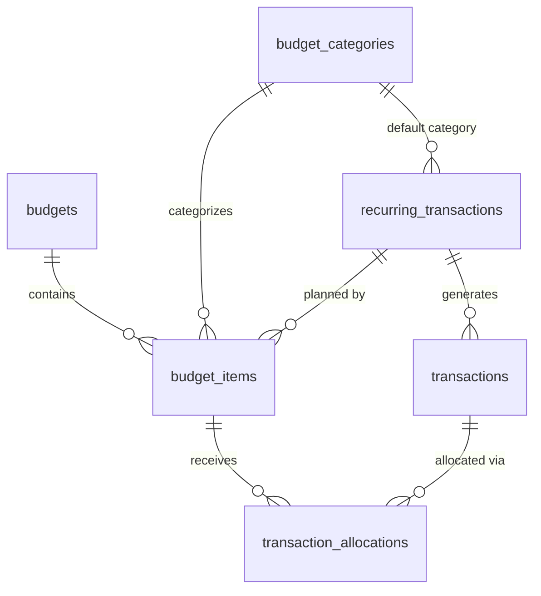

# Finance Module (`finance` schema)

*Status: planning draft. See [db-overview.md](db-overview.md) for conventions (audit columns, soft deletes, RLS, money types) that apply to every table below.*

**Replaces:** EveryDollar (budget plus every logged expense) **and** the Google Sheet bills checklist.

---

## 1. What the module does

From the brainstorm notes, plus functionality inferred from them and from the project inspiration doc (inferred items are marked ✱):

- **Create a budget for a period**: a week, a month or a year. A budget is just a container.
- **Plan line items** inside a budget ("Uber Eats: $120", "Paycheck: $3,000"). Each item is an expected **expense or income** and falls under a **category** (Food, Utilities, ...).
- **Categories** come seeded with defaults, and users can add, rename and archive their own.
- **Log actual transactions** (income or expense) and assign them to budget items. One transaction can count toward **more than one budget**, e.g. the October monthly budget *and* the 2026 annual budget.
- **The user always picks exactly which budget(s) a transaction applies to.** Nothing is added to a budget automatically based on its date. In practice you usually add a transaction *from a budget's page*, so the "apply to budget" field is pre-filled with that budget, and others can be added. *(The detailed UI is to be designed later.)*
- ✱ **Split a transaction** across items (one Target run: $40 groceries + $25 household). This uses the same mechanism as the multi-budget case.
- **Recurring transactions** (subscriptions, rent, bills) are stored as rules and **auto-logged** on schedule.
- **Auto-logged transactions need user verification**: they start as *pending*, and the user confirms them (adjusting the amount if, say, the electric bill came in different).
- ✱ **Bills checklist view**: this month's recurring transactions with pending/confirmed status *is* the old bills sheet. Confirming a bill *is* logging the expense, so the double-log goes away (inspiration doc principle #2).
- ✱ **Budget vs. actual** per item, per category and per budget.
- ✱ **"Needs assignment" inbox**: confirmed transactions that aren't allocated to any budget item yet.
- ✱ **Copy last period's budget** to start a new one (items, planned amounts and recurring links carry over). This is an API operation and needs no extra table.
- ✱ **Fast entry helpers** (recent payees, last-used item for a payee), which come from querying `transactions` and need no extra table.

---

## 2. Entity diagram

(Every table also has `user_id → core.users`, omitted for readability.)

### Changes from the brainstorm notes
- **Added `transaction_allocations`** (junction between `transactions` and `budget_items`). The notes say a transaction can be tied to multiple budgets, which needs a many-to-many link. Linking to the **budget item** rather than the budget itself is what makes item-level budget vs. actual possible, and it gives transaction splitting for free.
- **Transactions have no `category_id`.** The category comes from the budget item a transaction is allocated to, which avoids two sources of truth disagreeing. Unallocated transactions show up in the "needs assignment" inbox.
- **The "approved" flag lives on each generated transaction** (`status = pending | confirmed`), not only on the recurring rule. The rule gets an `is_auto_confirmed` option for things you never want to verify by hand.

---

## 3. Tables

### `budgets`
A container for one period.

| Column | Type | Null | Notes |
|---|---|---|---|
| `id`, `user_id` | `uuid` | no | |
| `name` | `text` | no | Defaults to something like "October 2026", but the user can edit it. |
| `period_type` | `text` | no | `CHECK IN ('week','month','year')` |
| `period_start` | `date` | no | 1st of the month / Jan 1 / the user's week-start day. |
| `period_end` | `date` | no | Inclusive. Set by the API from type and start; stored to keep range queries simple. |
| `notes` | `text` | yes | |

- Unique `(user_id, period_type, period_start)`: one October budget, one 2026 budget, and so on.
- `CHECK (period_end >= period_start)`.

### `budget_categories`
The "buckets": Food, Utilities, Transportation...

| Column | Type | Null | Notes |
|---|---|---|---|
| `id`, `user_id` | `uuid` | no | |
| `name` | `text` | no | Unique per user (case-insensitive). |
| `color` | `text` | yes | Hex, for charts. |
| `icon` | `text` | yes | |
| `sort_order` | `integer` | no | Default `0`. |
| `is_default` | `boolean` | no | True if copied from the seed list at signup. |

**Placeholder seed list** (to be replaced with the real EveryDollar categories): Income, Housing, Utilities, Food, Transportation, Health, Insurance, Subscriptions, Personal, Entertainment, Giving, Savings, Debt.

### `budget_items`
A planned line in a specific budget.

| Column | Type | Null | Notes |
|---|---|---|---|
| `id`, `user_id` | `uuid` | no | |
| `budget_id` | `uuid` | no | → `budgets` |
| `category_id` | `uuid` | no | → `budget_categories` |
| `name` | `text` | no | Free text, e.g. "Uber Eats". |
| `kind` | `text` | no | `CHECK IN ('expense','income')` |
| `planned_amount` | `numeric(12,2)` | no | `>= 0` |
| `recurring_transaction_id` | `uuid` | yes | → `recurring_transactions`. Set when the item exists to plan for a recurring bill or paycheck, which lets auto-logged transactions find their item. |
| `sort_order` | `integer` | no | Default `0`. |
| `notes` | `text` | yes | |

- Unique `(budget_id, recurring_transaction_id)` where not null, so a recurring rule maps to at most one item per budget.

### `transactions`
Money that actually moved (or, while `pending`, is expected to).

| Column | Type | Null | Notes |
|---|---|---|---|
| `id`, `user_id` | `uuid` | no | |
| `kind` | `text` | no | `CHECK IN ('expense','income')` |
| `amount` | `numeric(12,2)` | no | `> 0` |
| `occurred_on` | `date` | no | Day it happened, in the user's timezone. |
| `payee` | `text` | yes | Merchant or income source ("Kroger", "Employer"). Drives "recent payees" autocomplete. |
| `description` | `text` | yes | |
| `status` | `text` | no | `CHECK IN ('pending','confirmed')`, default `'confirmed'`. Manually logged transactions are confirmed right away. |
| `confirmed_at` | `timestamptz` | yes | When the user verified it (or when it was created, for manual entries). |
| `recurring_transaction_id` | `uuid` | yes | → `recurring_transactions`. Set if generated from a rule. |
| `scheduled_on` | `date` | yes | For generated rows: the occurrence date the rule produced. Stays fixed even if the user edits `occurred_on`. |
| `notes` | `text` | yes | |

- Unique `(recurring_transaction_id, scheduled_on)` where not null, which makes the generator job idempotent.
- **Actuals only count `confirmed` transactions.** Pending ones show up as "expected" or "projected".

### `transaction_allocations`
Links a transaction to the budget item(s) it counts toward.

| Column | Type | Null | Notes |
|---|---|---|---|
| `id`, `user_id` | `uuid` | no | |
| `transaction_id` | `uuid` | no | → `transactions` |
| `budget_item_id` | `uuid` | no | → `budget_items` |
| `amount` | `numeric(12,2)` | no | `> 0`. The portion of the transaction counted toward this item. |

- Unique `(transaction_id, budget_item_id)`.
- **Rules enforced by the API** (these span rows, so they can't be simple CHECKs):
  - The item's `kind` matches the transaction's `kind`.
  - Within any **one** budget, a transaction's allocations sum to at most its `amount`. Across different budgets the same dollars can count again, which is the point.
- **The date isn't enforced.** A transaction dated outside a budget's period can still be allocated to it (e.g. November rent paid on Oct 30 goes in the November budget). The UI may show a soft warning.
- **Allocations are only ever created by an explicit user choice.** No allocation is inferred from dates or categories.
- **Common case:** one allocation, for the full amount, to an item in the budget whose page you're on. The UI and MCP just ask "which item?" and the API writes the row(s).

### `recurring_transactions`
A rule for money that moves on a schedule: subscriptions, rent, utilities, paychecks.

| Column | Type | Null | Notes |
|---|---|---|---|
| `id`, `user_id` | `uuid` | no | |
| `name` | `text` | no | "Netflix", "Rent". |
| `kind` | `text` | no | `CHECK IN ('expense','income')` |
| `amount` | `numeric(12,2)` | no | Expected amount. |
| `is_amount_variable` | `boolean` | no | Default `false`. True for things like utilities, where the UI prompts for the real amount when confirming. |
| `category_id` | `uuid` | no | → `budget_categories`. Used when auto-creating budget items for this rule. |
| `payee` | `text` | yes | Copied onto generated transactions. |
| `recurrence_rule` | `text` | no | RRULE, e.g. `FREQ=MONTHLY;BYMONTHDAY=15`. |
| `starts_on` | `date` | no | |
| `ends_on` | `date` | yes | For subscriptions that end, or loans paid off. |
| `is_autopay` | `boolean` | no | Default `false`. Informational ("the bank pays this automatically"), shown on the checklist. |
| `is_auto_confirmed` | `boolean` | no | Default `false`. If true, generated transactions are created as `confirmed` and skip verification. |
| `paused_at` | `timestamptz` | yes | Paused rules generate nothing. |
| `notes` | `text` | yes | |

---

## 4. How the features map to the tables

| Feature | How |
|---|---|
| **Auto-logging** | A scheduled job (EventBridge, daily) expands each active rule's RRULE and inserts `pending` transactions for occurrences in the current month, using `scheduled_on` for idempotency. Generated transactions start with **no allocations**. |
| **Bills checklist** | `transactions WHERE recurring_transaction_id IS NOT NULL AND scheduled_on` is in this month, shown with status. Checking one off sets `status = 'confirmed'` (and updates `amount` if it was variable). The confirm dialog **pre-fills** the budget item(s) linked to that rule (`budget_items.recurring_transaction_id`). The user accepts or changes them, and only then are allocations written. |
| **Budget vs. actual (item)** | `budget_items.planned_amount` vs. `SUM(transaction_allocations.amount)` over confirmed transactions. |
| **Budget vs. actual (category)** | The same, grouped by `budget_items.category_id`. |
| **Needs-assignment inbox** | Confirmed transactions with no `transaction_allocations` rows. |
| **Copy last budget** | Clone `budget_items` (name, category, kind, planned amount, recurring link) into a new budget row. |

---

## 5. Open questions

1. **Real category list** from EveryDollar, and whether categories need **groups** (EveryDollar groups budget lines). If so, add a nullable `parent_id` to `budget_categories`.
2. **Should categories be typed** as income or expense, or stay neutral as drafted?
3. **More than one budget per period?** The draft says no (unique per type and start). Say so if you want, for example, a separate "vacation" budget for the same month.
4. **Accounts:** does tracking *which account* paid (checking vs. credit card) matter? The bills sheet may have had an account column. This would add an `accounts` table and `transactions.account_id`.
5. **Pending generation window:** generate a month's recurring transactions at the start of the month (the full checklist is visible early), or on each due date?
6. **Historical import** of EveryDollar expenses: is it wanted, and how far back?
