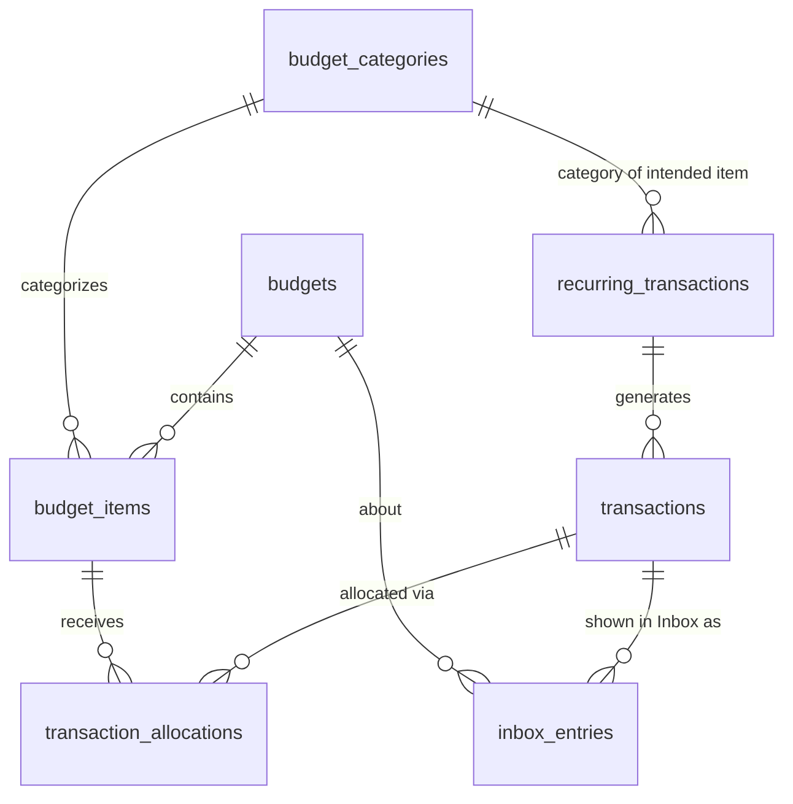

# Finance Module (`finance` schema)

*Status: **implemented**; every table and column below is built. Migrations: `db/migrations/*_finance__*.sql`. One column is retired and unused, awaiting a drop (`recurring_transactions.requires_approval`; see [roadmap.md](../roadmap.md)). See [db-overview.md](db-overview.md) for conventions (audit columns, soft deletes, RLS, money types) that apply to every table below. The API is in [api-overview.md](../api/api-overview.md) §7.1 and the screens in [finance-ui.md](../ui/finance-ui.md).*

**Replaces:** EveryDollar (budget plus every logged expense) **and** the Google Sheet bills checklist.

---

## 1. What the module does

From the brainstorm notes, plus functionality inferred from them and from the project inspiration doc (inferred items are marked ✱):

- **Create a budget for a period**: a week, a month or a year. A budget is just a container, and a period can have **more than one budget** (e.g. "October 2026" and "October – Vacation").
- **Plan line items** inside a budget ("Uber Eats: $120", "Paycheck: $3,000"). Each item is an expected **expense or income**, and can **optionally** be put in a **category**. Items without one show as **Uncategorized**.
- **Categories** are typed too: each belongs under **Expenses** or **Incomes**, and only items of the same type can use it. Expense categories come pre-made; users can add, rename, describe (optional description) and archive their own of either type.
- **Reorder** categories (per user, applies to every budget) and items (per budget) by dragging: `sort_order` on both; item order carries over when a budget is copied.

How a budget reads:

```
Incomes
├── <custom income category>
│   └── Paycheck
└── Uncategorized
    └── Side gig

Expenses
├── Housing
│   └── Rent
├── Food
│   ├── Groceries
│   └── Uber Eats
├── <custom expense category>
│   └── ...
└── Uncategorized
    └── Birthday gift
```
- **Log actual transactions** (income or expense) and assign them to budget items. One transaction can count toward **more than one budget**, e.g. the October monthly budget *and* the 2026 annual budget. A transaction has optional **notes**.
- **For manually logged transactions, the user always picks exactly which budget(s) a transaction applies to.** Nothing is added to a budget based on its date. In practice you usually add a transaction *from a budget's page*, so the item is pre-filled. The one exception is a recurring rule the user explicitly set to **"Auto-apply"** (below), and even then only toward the item the rule names.
- ✱ **Split a transaction** across items (one Target run: $40 groceries + $25 household). This uses the same mechanism as the multi-budget case. The API supports it; the UI writes one allocation per budget.
- **Recurring transactions** (subscriptions, rent, bills, paychecks) are stored as rules and **auto-logged "on its date"**: one transaction per occurrence, created by an hourly job once the date arrives in the user's timezone (§3 `recurring_transactions`).
- **Auto-apply or approve**: a rule names the **budget item** it's meant for (`item_name` + category). With **auto-apply** on, each occurrence is logged confirmed and counted toward the matching item in every budget covering its date; a budget without a matching item asks the user (in the Inbox) which item to use. With auto-apply off, or when no budget covers the date, the occurrence is *pending* and waits in the Inbox for the user to approve it (adjusting the amount if, say, the electric bill came in different) and pick where it counts, or reject it. Items are never created automatically.
- **Monthly checklist** (the old bills sheet): items in a monthly budget can be flagged as checklist items with a due day. An item is **done** once its confirmed net actual reaches its planned amount (and is more than 0), or, for items set to **"Any payment"** (bills that vary, like utilities), once anything confirmed has been paid. So paying the bill *is* ticking it off (inspiration doc principle #2); there is no separate "done" flag. A recurring rule's payment (e.g. an autopay bill with `auto_apply`) completes the item the same way, by bringing its actual up to plan (or, for an "Any payment" item, by being paid).
- ✱ **Budget vs. actual** per item, per category and per budget.
- ✱ **Inbox**: decisions recurring rules need from the user ("Needs you": approve and place a pending occurrence, or pick an item in a budget that had no match), confirmed transactions that aren't allocated to any budget item yet ("Not in a budget", with a way to assign them), and a ledger of what rules applied automatically, with read state (§3 `inbox_entries`).
- ✱ **Copy a budget** to start a new one, as an option on budget creation (`copy_from_budget_id` on `POST /finance/budgets`): the source must be the user's own budget of the same period type. Items carry over (kind, category, name, planned amount, sort order, notes, checklist flag, day and mode; items whose category was deleted come across Uncategorized); transactions and allocations do not. No extra table.
- **Display preferences**: per-user settings for the budget page, currently whether to show the "$x of $y" subtotals beside category headings and beside the Income / Expenses headings (both off by default; §3 `preferences`).

---

## 2. Entity diagram



(Every table also has `user_id → core.users`, omitted for readability.) A recurring rule has **no foreign key to budget items**: it finds its item in each budget by kind + `item_name` + category (§4).

### Changes from the brainstorm notes
- **Added `transaction_allocations`** (junction between `transactions` and `budget_items`). The notes say a transaction can be tied to multiple budgets, which needs a many-to-many link. Linking to the **budget item** rather than the budget itself is what makes item-level budget vs. actual possible, and it gives transaction splitting for free.
- **Transactions have no `category_id`.** The category comes from the budget item a transaction is allocated to, which avoids two sources of truth disagreeing. Unallocated transactions show up in the inbox.
- **Categories are optional and typed.** `budget_items.category_id` is nullable (NULL = Uncategorized; there is no "Uncategorized" row), and every category has a `kind`. A composite foreign key makes the database reject an expense item in an income category.
- **No category groups.** An earlier idea of group/subgroup levels was dropped: the expense/income type is the top level, and categories sit directly under it.
- **The "approved" flag lives on each generated transaction** (`status = pending | confirmed`). An occurrence starts `pending` when its rule doesn't auto-apply (or no budget covers its date), and is approved from the Inbox.
- **The checklist hangs off budget items, not recurring rules.** A checklist item is any monthly-budget item flagged `is_checklist_item`, so a bill doesn't need a recurring rule to be on the checklist.

---

## 3. Tables

### `budgets`
A container for one period.

| Column | Type | Null | Notes |
|---|---|---|---|
| `id`, `user_id` | `uuid` | no | |
| `name` | `text` | no | Defaults to something like "October 2026", but the user can edit it. Tells apart budgets that share a period. |
| `period_type` | `text` | no | `CHECK IN ('week','month','year')` |
| `period_start` | `date` | no | 1st of the month / Jan 1 / the user's week-start day. |
| `period_end` | `date` | no | Inclusive. Set by the API from type and start; stored to keep range queries simple. |
| `notes` | `text` | yes | |

- **No uniqueness on the period:** several budgets can cover the same month (e.g. a regular one and a vacation one).
- `CHECK (period_end >= period_start)`.
- **Effective date range:** `period_start`..`period_end`, inclusive. A budget is **active** when today, in the user's timezone (`core.users.timezone`), falls within it; computed in the web app (no column). Overlapping budgets (a monthly and a yearly one, or two for the same month) can all be active at once.
- Unique `(id, user_id)`: target of `budget_items`' composite FK (§3.1).
- The API derives `period_start` / `period_end` from `period_type` plus any date in the period (weeks use `core.users.week_starts_on`) and defaults `name` to "October 2026", "2026" or "Week of Oct 19, 2026".

### `budget_categories`
Optional buckets for budget items, each under Expenses or Incomes.

| Column | Type | Null | Notes |
|---|---|---|---|
| `id`, `user_id` | `uuid` | no | |
| `kind` | `text` | no | `CHECK IN ('expense','income')`. Which side of the budget the category lives on. |
| `name` | `text` | no | Unique per user **and kind** (case-insensitive). |
| `description` | `text` | yes | Optional, defaults to NULL (the seeded defaults have none). Editable on the Categories page; the API caps it at 300 chars. |
| `color` | `text` | yes | Hex, for charts. |
| `icon` | `text` | yes | |
| `sort_order` | `integer` | no | Default `0`. **Per user, per kind**, and the same in every budget. New categories go last (`max + 1`). Set for a whole kind at once by `PUT /finance/categories/order` (each id gets its position in the list). |
| `is_default` | `boolean` | no | True if copied from the seed list when the module was first enabled. |

- Unique `(id, kind, user_id)`: redundant with the PK, but it's the target of the composite foreign keys that keep item and category types (and owners) consistent (see `budget_items` and §3.1).
- Name uniqueness is a partial unique index on `(user_id, kind, lower(name)) WHERE deleted_at IS NULL`; the API returns **409** on a duplicate.

**Seed list** (expense categories, copied in by the module's `setup` the first time a user turns on Finance): Housing, Insurance, Utilities, Transportation, Debts, Savings, Food, Personal, Health. **No default income categories**; users create their own.

**Backfill:** `db/migrations/20261025153025_finance__backfill_default_categories.sql` is a one-time data migration for users who turned Finance on before the module existed and so never ran its first-enable `setup`. It gives the seed list to users who have Finance enabled and **no** category rows at all (deleted or not), so it never re-adds categories someone deleted on purpose. The default list now lives in two places: `DEFAULT_EXPENSE_CATEGORIES` in `api/app/modules/finance/service.py` and this migration. The migration's copy is frozen history; future changes to the defaults only change `service.py`.

### `budget_items`
A planned line in a specific budget.

| Column | Type | Null | Notes |
|---|---|---|---|
| `id`, `user_id` | `uuid` | no | |
| `budget_id` | `uuid` | no | → `budgets` |
| `kind` | `text` | no | `CHECK IN ('expense','income')` |
| `category_id` | `uuid` | yes | → `budget_categories`. **NULL = Uncategorized.** |
| `name` | `text` | no | Free text, e.g. "Uber Eats". Also how a recurring rule finds its item (kind + name ignoring case and extra spaces + category; §4). |
| `planned_amount` | `numeric(12,2)` | no | `>= 0` |
| `sort_order` | `integer` | no | Default `0`. **Per budget.** New items go last; set by `PUT /finance/budgets/{id}/items/order`; copied with the budget. Items sort within their category group. |
| `is_checklist_item` | `boolean` | no | Default `false`. On the monthly checklist. The API only allows it on items in **monthly** budgets (422 otherwise). |
| `checklist_day` | `smallint` | yes | `CHECK BETWEEN 1 AND 28`. Day of the budget's month it's due. Set exactly when `is_checklist_item` (`budget_items_checklist_check`). |
| `checklist_mode` | `text` | no | `CHECK IN ('full_amount','any_payment')`, default `'full_amount'`. When a checklist item counts as done: `full_amount` once the confirmed net actual reaches the plan, `any_payment` once anything confirmed has been paid (§4). Keeps its default on non-checklist items, where it means nothing. |
| `notes` | `text` | yes | |

- `FOREIGN KEY (category_id, kind, user_id) REFERENCES budget_categories (id, kind, user_id)`: an item can only use a category of its own type (and its own user's). With `category_id` NULL the check is skipped (standard `MATCH SIMPLE`), which is exactly "Uncategorized".
- `FOREIGN KEY (budget_id, user_id) REFERENCES budgets (id, user_id)`; unique `(id, user_id)` as the target for allocations.
- **No link to recurring rules.** An earlier plan had `budget_items.recurring_transaction_id`; it was dropped because rules match items by name and category, which also works for items the user created by hand and survives copying a budget.

### `transactions`
Money that actually moved (or, while `pending`, is expected to).

| Column | Type | Null | Notes |
|---|---|---|---|
| `id`, `user_id` | `uuid` | no | |
| `kind` | `text` | no | `CHECK IN ('expense','income')` |
| `amount` | `numeric(12,2)` | no | `> 0` |
| `occurred_on` | `date` | no | Day it happened, in the user's timezone. Generated transactions use the occurrence date. |
| `payee` | `text` | yes | Merchant or income source ("Kroger", "Employer"). Generated transactions copy the rule's. |
| `description` | `text` | yes | |
| `notes` | `text` | yes | Free text, entered in the transaction form (API cap 1,000 chars). Generated transactions copy the rule's notes. |
| `status` | `text` | no | `CHECK IN ('pending','confirmed')`, default `'confirmed'`. Occurrences from rules that don't auto-apply (or whose date no budget covers) are created `pending`, with a `place` Inbox entry; everything else is confirmed on creation. |
| `recurring_transaction_id` | `uuid` | yes | → `recurring_transactions`. Set if generated from a rule. |
| `scheduled_on` | `date` | yes | For generated rows: the occurrence date the rule produced. Set exactly when `recurring_transaction_id` is (`transactions_recurring_scheduled_check`). |

- Unique `(id, user_id)`.
- **Unique `(recurring_transaction_id, scheduled_on)` where `recurring_transaction_id IS NOT NULL`** (`transactions_recurring_occurrence_key`). Deliberately **not** limited to undeleted rows, so the generator is idempotent *and* a rejected or deleted occurrence is never generated again.
- Partial index on `user_id` where `status = 'pending' AND deleted_at IS NULL`. (The Inbox now lists pending ones through their `inbox_entries` rows.)
- **Actuals only count `confirmed` transactions.** Pending ones are reported separately as each item's `pending_amount` ("awaiting approval").
- **Approve** sets `status = 'confirmed'` and, optionally, a corrected `amount`. Both happen in the Inbox on a `place` entry: approving (`POST /finance/inbox/{id}/resolve`) also replaces its allocations with the items the user picked, in full; **rejecting** (`POST /finance/inbox/{id}/dismiss`) soft-deletes it. Either way the entry is closed.

### `transaction_allocations`
Links a transaction to the budget item(s) it counts toward.

| Column | Type | Null | Notes |
|---|---|---|---|
| `id`, `user_id` | `uuid` | no | |
| `transaction_id` | `uuid` | no | → `transactions` |
| `budget_item_id` | `uuid` | no | → `budget_items` |
| `amount` | `numeric(12,2)` | no | `> 0`. The portion of the transaction counted toward this item. |

- Unique `(transaction_id, budget_item_id)`.
- FKs `(transaction_id, user_id) → transactions (id, user_id)` and `(budget_item_id, user_id) → budget_items (id, user_id)` (see §3.1).
- **Hard-deleted, no `deleted_at`.** An exception to the soft-delete convention: allocations are replaced rather than edited and carry no history of their own, so they are deleted outright (they still have `created_at` / `updated_at`). `PUT /finance/transactions/{id}/allocations` replaces a transaction's whole set (used to assign from the inbox), and so does editing a transaction (`PUT /finance/transactions/{id}`).
- **A transaction of either kind can be allocated to an item of either kind.** An income transaction on an expense item is a **credit** against it (a grocery rebate or a return reduces what Groceries actually cost), and an expense on an income item reduces what it brought in. See "Budget vs. actual" in §4 for the netting.
- **Rule enforced by the API** (it spans rows, so it can't be a simple CHECK): within any **one** budget, a transaction's allocations sum to at most its `amount`. Across different budgets the same dollars can count again, which is the point.
- **The date isn't enforced.** A transaction dated outside a budget's period can still be allocated to it (e.g. November rent paid on Oct 30 goes in the November budget). The UI may show a soft warning.
- **Allocations come from an explicit user choice**: picking an item when logging or assigning, or turning on a rule's `auto_apply`, which allocates that rule's transactions to every budget covering the date (§4). No allocation is ever inferred from categories.
- **Common case:** one allocation, for the full amount, to an item in the budget whose page you're on. The UI and MCP just ask "which item?" and the API writes the row(s).

### `recurring_transactions`
A rule for money that moves on a schedule: subscriptions, rent, utilities, paychecks. The schedule is stored as **explicit columns**, not an RRULE.

| Column | Type | Null | Notes |
|---|---|---|---|
| `id`, `user_id` | `uuid` | no | |
| `kind` | `text` | no | `CHECK IN ('expense','income')` |
| `name` | `text` | no | "Netflix", "Rent". Non-blank. Just the rule's label. |
| `item_name` | `text` | no | Non-blank (`recurring_transactions_item_name_check`). The **budget item it's meant for**, free text, matched in each budget by kind + name ignoring case and extra spaces + category (§4). Added by the Inbox migration, backfilled from `name` (with the `updated_at` trigger off, so existing rules kept their `updated_at`), since until then the name was the item. |
| `category_id` | `uuid` | yes | → `budget_categories` (same composite `(category_id, kind, user_id)` key as budget items). The intended item's category, part of the match; NULL = Uncategorized (matches only Uncategorized items). |
| `amount` | `numeric(12,2)` | no | `> 0`. Expected amount (the approval step can correct it per transaction). |
| `payee` | `text` | yes | Copied onto generated transactions. |
| `notes` | `text` | yes | Copied onto generated transactions. |
| `frequency` | `text` | no | `CHECK IN ('weekly','monthly','quarterly','yearly')` |
| `day_of_week` | `smallint` | yes | ISO 1 = Mon … 7 = Sun. Set **exactly** for weekly rules. |
| `day_of_month` | `smallint` | yes | 1–28, so it exists every month. Set **exactly** for monthly rules. |
| `starts_on` | `date` | no | Earliest date for every frequency. **Quarterly and yearly repeat from it** (every 3 / 12 months on its day). Quarterly requires its day ≤ 28; yearly clamps Feb 29 to Feb 28 in other years. |
| `ends_on` | `date` | yes | Optional, `>= starts_on`. For subscriptions that end, or loans paid off. |
| `auto_apply` | `boolean` | no | Default `false`. **"Auto-apply"** (§4): count each occurrence toward the matching item in every budget covering its date. Off: each occurrence is pending and waits in the Inbox to be approved and placed. |
| `requires_approval` | `boolean` | no | Default `false`. **Retired:** always `false` (`20261028120000_finance__fold_requires_approval.sql` folded it into `auto_apply`), and no code reads or writes it. To be dropped ([roadmap.md](../roadmap.md)). |
| `paused_at` | `timestamptz` | yes | Paused rules generate nothing. The API exposes it as a `paused` boolean. |

- Unique `(id, user_id)`: target of `transactions`' composite FK.
- CHECKs: `(frequency = 'weekly') = (day_of_week IS NOT NULL)`, the same for monthly / `day_of_month`, quarterly start day ≤ 28, `ends_on >= starts_on`. The API validates the same rules (422) before the database sees them.
- **Editing a rule** changes future occurrences only; transactions it already created stay as they are. **Deleting** (soft) stops future occurrences and keeps its transactions.
- **`finance.users_with_recurring()`**, `SECURITY DEFINER`: returns only `(user_id, timezone)` for users with at least one active (undeleted, unpaused) rule. The hourly job needs that one cross-user lookup; everything else it does per user under RLS (§4). `EXECUTE` is granted only to `disci_app`.

### `preferences`
Per-user display settings. **One row per user**, upserted on save (`PUT /finance/preferences`); there's no row until the user first saves, and the API returns the defaults (everything off) until then. Like `nutrition.preferences`, it has **no `deleted_at`**.

| Column | Type | Null | Notes |
|---|---|---|---|
| `id` | `uuid` | no | |
| `user_id` | `uuid` | no | **Unique.** → `core.users` |
| `show_category_totals` | `boolean` | no | Default `false`. Show "$x of $y" beside each category heading on a budget page. |
| `show_kind_totals` | `boolean` | no | Default `false`. The same beside the Income and Expenses headings. |

RLS owner policy and the usual `updated_at` trigger.

### `inbox_entries`
What the Inbox shows about a transaction from a recurring rule (§4): a decision to make, or a ledger line for something applied automatically. Created by the generator, never by hand. **No `deleted_at`**: entries are resolved, not deleted.

| Column | Type | Null | Notes |
|---|---|---|---|
| `id`, `user_id` | `uuid` | no | |
| `transaction_id` | `uuid` | no | → `transactions` |
| `kind` | `text` | no | `CHECK IN ('applied','pick_item','place')`. `applied`: auto-applied to `budget_item_id` in `budget_id` (the ledger). `pick_item`: auto-apply found no matching item in `budget_id`; the user picks one. `place`: the transaction is pending (auto-apply off, or no budget covered the date); the user approves it and picks where it counts. |
| `budget_id` | `uuid` | yes | → `budgets`. NULL **exactly** for `place`. |
| `budget_item_id` | `uuid` | yes | → `budget_items`. `applied`: where it landed (required). `pick_item`: the item the user picked, once resolved. |
| `resolution` | `text` | yes | `CHECK IN ('done','skipped','rejected')`. NULL = open. `applied` entries never have one. `done`: resolved (placed / item picked); `skipped`: a `pick_item` the user skipped; `rejected`: a `place` whose transaction was rejected. |
| `resolved_at` | `timestamptz` | yes | Set exactly when `resolution` is. |
| `seen_at` | `timestamptz` | yes | Ledger read state: when the user marked `applied` entries read. |

- CHECKs: `(kind = 'place') = (budget_id IS NULL)`; `applied` needs `budget_item_id` and no `resolution`; `(resolution IS NULL) = (resolved_at IS NULL)`.
- Indexes: `inbox_entries_open_idx` on `(user_id, created_at)` where `kind <> 'applied' AND resolution IS NULL` (Needs you); `inbox_entries_ledger_idx` on `(user_id, created_at DESC)` where `kind = 'applied'`; `inbox_entries_transaction_idx` on `transaction_id`.
- RLS owner policy and the usual `updated_at` trigger.
- **Pre-Inbox data:** the migration created a `place` entry for every undeleted pending transaction that existed then (its `created_at` copied); those transactions and their allocations were left untouched, which is why the API returns a `place` entry's current allocations.
- Entries whose transaction or budget was later deleted drop out of the Inbox (the queries join them away); they aren't cleaned up.

### 3.1 Tenant guard: composite foreign keys

RLS limits what a user can **see**, but foreign-key checks bypass RLS. Without a guard, a user who guessed another user's row id could point a row at it (e.g. allocate their transaction to someone else's budget item). So every parent table has a unique `(id, user_id)` (categories: `(id, kind, user_id)`), and **every child FK includes `user_id`**:

| Child | Foreign key |
|---|---|
| `budget_items` | `(budget_id, user_id) → budgets (id, user_id)` |
| `budget_items` | `(category_id, kind, user_id) → budget_categories (id, kind, user_id)`, `MATCH SIMPLE`, so NULL = Uncategorized skips it |
| `recurring_transactions` | `(category_id, kind, user_id) → budget_categories (id, kind, user_id)`, `MATCH SIMPLE` |
| `transactions` | `(recurring_transaction_id, user_id) → recurring_transactions (id, user_id)` (`transactions_recurring_fk`), `MATCH SIMPLE` |
| `inbox_entries` | `(transaction_id, user_id) → transactions`, `(budget_id, user_id) → budgets`, `(budget_item_id, user_id) → budget_items` (the last two `MATCH SIMPLE`, so NULLs skip them) |
| `transaction_allocations` | `(transaction_id, user_id) → transactions (id, user_id)` |
| `transaction_allocations` | `(budget_item_id, user_id) → budget_items (id, user_id)` |

Combined with RLS's `WITH CHECK (user_id = core.current_user_id())`, a row can only reference parents owned by the same user. This is a convention for every module (see [db-overview.md](db-overview.md) §2, Integrity).

### 3.2 Delete behavior

| Deleting | What happens |
|---|---|
| A category | Soft-deleted; its items' `category_id` is set to NULL (they become Uncategorized). Recurring rules using it are uncategorized too (so they then match Uncategorized items). |
| A budget item | Soft-deleted; its allocations are hard-deleted, so those transactions become unassigned. |
| A budget | Soft-deleted along with its items; their allocations are hard-deleted (transactions become unassigned). |
| A transaction (or rejecting a pending one) | Soft-deleted; its allocations are hard-deleted. A generated occurrence is never re-created (the unique index includes deleted rows). Its Inbox entries stay but drop out of the Inbox; rejecting marks its `place` entry `rejected`. |
| A recurring rule | Soft-deleted; nothing more is generated. Transactions it already created stay. |

### 3.3 Dev seed

`db/seeds/dev.sql` gives the local dev user the default expense categories, a custom income category "Salary", and a budget for the current month with sample items and transactions (including a $25 grocery rebate, an income transaction credited against Groceries). It only creates the budget if none exists for that month.

---

## 4. How the features map to the tables

| Feature | How |
|---|---|
| **Auto-logging** | For each active rule, `generate_for_user` (`api/app/modules/finance/recurring.py`) computes its occurrences from the date the rule was **created** (in the user's timezone; never earlier) up to **today** in the user's timezone, and inserts one transaction per occurrence with `occurred_on = scheduled_on = ` that date, `ON CONFLICT DO NOTHING` on the occurrence index. It runs hourly for every user with active rules (`app/jobs/recurring.py`, the `disci-jobs` Lambda) and also immediately after a rule is created or updated, so a rule due today logs right away. |
| **Auto-apply** | If the rule's `auto_apply` is on **and** at least one budget covers the date, the transaction is `confirmed`. For each covering budget it looks for an item with the rule's kind, the same name ignoring case and extra whitespace, and the same category (`IS NOT DISTINCT FROM`, so Uncategorized matches Uncategorized; `queries/find_rule_item.sql`, oldest first). A match gets an allocation of the **full amount** and an `applied` ledger entry; no match gets a `pick_item` entry for that budget. **Items are never created automatically.** |
| **Approvals** | Otherwise (auto-apply off, or no budget covers the date) the transaction is `pending` with no allocations and a single `place` entry. Pending transactions don't count in actuals (each item's `pending_amount` shows any that are allocated). Resolving the `place` entry approves it (optionally with a corrected amount) and replaces its allocations with the full amount on each picked item (at most one per budget, possibly none, which leaves it under "Not in a budget"); dismissing it rejects it (soft delete, the date never regenerates). |
| **Inbox** | `GET /finance/inbox` (`api/app/modules/finance/routes/inbox.py`): `needs_you` (open `pick_item` / `place` entries, oldest transaction first, `queries/list_inbox_open.sql`), `unassigned` (confirmed transactions with no allocation to an undeleted item, newest first), `ledger` (last 50 `applied` entries, newest first) and `unseen`. Resolve a `pick_item` with exactly one item in its budget (422 if the transaction already counts there) or skip it; `POST /finance/inbox/seen` sets `seen_at` on the ledger. Assigning an unassigned transaction writes allocations with `PUT /finance/transactions/{id}/allocations`. |
| **Monthly checklist** | `GET /finance/checklist`: items with `is_checklist_item` in the **monthly** budget(s) covering today (user's timezone), with `due_on = period_start + checklist_day - 1`, `actual_amount` (net over **confirmed** allocated transactions: same kind adds, opposite kind subtracts, so a refund can un-tick an item; pending ones don't count), `last_payment_on` (latest `occurred_on` among those confirmed transactions) `checklist_mode`, and `done` = `actual_amount > 0 AND (checklist_mode = 'any_payment' OR actual_amount >= planned_amount)` (`queries/list_checklist.sql`). So a $0-planned item still needs something logged, and an `any_payment` item ticks off on its first confirmed payment whatever the amount. Budget detail exposes the same rule as each item's `checklist_done` (`queries/list_budget_items.sql`). A rule with `auto_apply` completes the item when its payments bring the actual up to plan (or, for `any_payment`, on its first confirmed payment). |
| **Display preferences** | `GET /finance/preferences` returns the user's `preferences` row, or both flags `false` if there is none; `PUT /finance/preferences` upserts both flags (sent in full). The web budget page hides the subtotals unless the matching flag is on. |
| **Reorder** | `budget_categories.sort_order` (per user and kind) and `budget_items.sort_order` (per budget), each set from an ordered id list. Budget detail sorts items by kind, category `sort_order` (Uncategorized last), then item `sort_order`. |
| **Budget vs. actual (item)** | `budget_items.planned_amount` vs. the **net** of allocations over **confirmed** transactions: transactions of the item's own kind add, the opposite kind subtracts. `SUM(CASE WHEN t.kind = i.kind THEN a.amount ELSE -a.amount END)`. Groceries: $380 spent − $25 rebate = $355 actual. Can go negative (a net credit). `actual_amount` and `pending_amount` in `GET /finance/budgets/{id}` (`queries/list_budget_items.sql`). |
| **Budget vs. actual (category)** | The same, grouped by `budget_items.kind` then `category_id` (NULL shown as "Uncategorized"). |
| **Copy a budget** | Creating a budget with `copy_from_budget_id` inserts the new `budgets` row, then clones the source's non-deleted `budget_items` (kind, category, name, planned amount, sort order, notes, `is_checklist_item`, `checklist_day`, `checklist_mode`) into it (`queries/copy_budget_items.sql`). A deleted category becomes NULL (Uncategorized). No transactions or allocations are copied. Recurring rules need no link: they find the copied items by name. |

---

## 5. Decisions

| Question | Decision |
|---|---|
| Category groups / subgroups? | **No.** Expense/income is the top level; categories sit directly under it. |
| Are categories typed? | **Yes**, `expense` or `income`, enforced against items by a composite FK. |
| Is a category required? | **No.** Items can be Uncategorized (NULL). |
| Category list | Expense defaults: Housing, Insurance, Utilities, Transportation, Debts, Savings, Food, Personal, Health. No income defaults. |
| More than one budget per period? | **Yes.** No uniqueness on the period; the name tells them apart. |
| Must a transaction's kind match its item's kind? | **No.** Opposite-kind transactions net against the item (refunds, rebates, returns). |
| Tenant integrity across users? | **Composite FKs** that include `user_id` on every child reference (§3.1), since FK checks bypass RLS. |
| Soft-delete allocations? | **No.** `transaction_allocations` are hard-deleted; they're replaced, not edited, and carry no history. |
| Track accounts (checking, credit card)? | **Not in v1.** Can be added later as an `accounts` table plus a nullable `transactions.account_id` without disturbing anything. |
| How is a recurring schedule stored? | **Explicit columns** (`frequency`, `day_of_week`, `day_of_month`, `starts_on`, `ends_on`), not an RRULE string. Four frequencies cover the real cases, are easy to validate with CHECKs and to edit in a form, and need no parser. |
| When are recurring transactions created? | **"On its date"**: one per occurrence once the date arrives in the user's timezone (hourly job), and immediately when a rule is saved. Never backfilled before the rule was created. |
| Where does a generated transaction go? | The user chooses per rule: **"Auto-apply"** (allocated in full to the matching item in every budget covering the date) or not (pending in the Inbox, to approve and place). Nothing lands somewhere the user didn't pick: auto-apply never creates an item, and a budget with no match becomes a `pick_item` decision. |
| Must the user verify generated transactions? | Only rules **without auto-apply** (and occurrences no budget covers). There's no separate approval flag: an approved transaction still needs placing, so approving and placing are one step in the Inbox. Auto-applied ones show in the Inbox ledger so the user can see what happened. |
| How do rules find their budget item? | **By kind + `item_name` (ignoring case and extra spaces) + category**, not a stored link, so a rule works with budgets created after it (including copies). `item_name` keeps the rule's label (`name`) separate from its target. |
| How is the Inbox stored? | **`inbox_entries` rows** created by the generator, one per decision or ledger line, resolved rather than deleted, so "needs you", "skipped" and the read state of the ledger are explicit instead of inferred from transaction state. |
| What counts as a checklist item, and when is it done? | A flagged item in a **monthly** budget with a due day (1–28). The user chose **strict completion**: done once its confirmed net actual is **≥ its planned amount and > 0**. Pending transactions don't count, and opposite-kind credits net (a refund can un-tick it). No per-transaction "satisfies the checklist" flag; a recurring rule's payment completes an item only by bringing its actual up to plan. Per item, `checklist_mode` picks `full_amount` (that strict rule, the default) or `any_payment` (done once confirmed net actual > 0), because variable bills like utilities rarely match their plan exactly. |
| Can a rejected or deleted occurrence come back? | **No.** The occurrence unique index includes deleted rows. |
| Where do finance display settings live? | A **`finance.preferences`** row per user (upserted, no soft delete), the same pattern as `nutrition.preferences`. The budget page's subtotals are **off by default**; each kind is its own flag. |
| Category and item order? | Category order is **per user** (one order for every budget); item order is **per budget** and is copied with it. Saved on each drop. |

## 6. Not built yet

See [roadmap.md](../roadmap.md).
