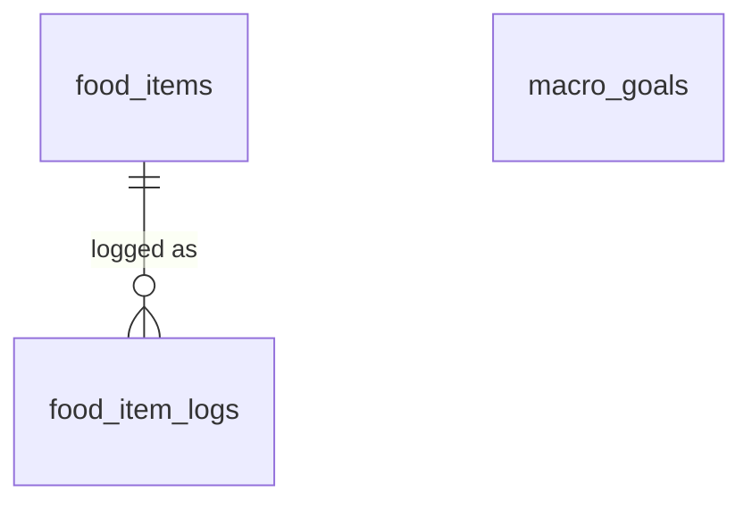

# Nutrition Module (`nutrition` schema)

*Status: planning draft. See [db-overview.md](db-overview.md) for conventions (audit columns, soft deletes, RLS) that apply to every table below.*

**Replaces:** the Google Sheet food repo plus its daily log tab.

---

## 1. What the module does

From the brainstorm notes, plus functionality inferred from the inspiration doc (inferred items are marked ✱):

- **Food catalog ("food repo"):** a reusable list of foods with nutrition **per serving**.
- **Food log:** each entry records *which food, how much, which day*.
- **Macro goals:** daily targets for calories, protein, carbs and fat.
- ✱ **Log in whatever unit is natural:** "1 banana" (servings), "150 g chicken" (grams) or "2 cups". The raw quantity and unit are stored, not just the resulting macros (principle #6).
- ✱ **Daily totals vs. goals** are computed live from the log joined to the catalog, never stored as the only record.
- ✱ **Goals can change over time** without rewriting history: last month's days are judged against last month's goals.
- ✱ **Optional meal grouping** (breakfast, lunch, dinner, snack) and optional exact time.
- ✱ **Foods can come from different sources** (typed in by hand, read off a label, looked up in USDA, or provided by Claude), with the source tracked.

---

## 2. Entity diagram

(Every table also has `user_id → core.users`, omitted for readability. `macro_goals` stands alone. It's matched to a day by date, not by a foreign key.)

### Changes from the brainstorm notes
- **Macro goals are effective-dated** (`effective_from`), giving a history of goals rather than a single editable row.
- **Log entries store `quantity` + `unit` as entered, plus a resolved `servings` multiplier**, so totals are a simple multiply-and-sum.

### Decisions
- **Editing a food's nutrition updates history (v1).** Past days that logged the food are recalculated with the new numbers. Foods aren't versioned. If that becomes a problem later, versioning means an edit creates a new row and soft-deletes the old one.

---

## 3. Tables

### `food_items`
The catalog. All nutrient values are **per one serving**.

| Column | Type | Null | Notes |
|---|---|---|---|
| `id`, `user_id` | `uuid` | no | |
| `name` | `text` | no | "Banana", "Chicken breast". |
| `brand` | `text` | yes | "Kirkland". Unique `(user_id, lower(name), coalesce(lower(brand), ''))`. |
| `serving_size` | `numeric(10,2)` | no | E.g. `1`, `100`, `0.5`. |
| `serving_unit` | `text` | no | E.g. `g`, `ml`, `piece`, `cup`, `slice`, `scoop`. |
| `serving_grams` | `numeric(10,2)` | yes | Grams in one serving when `serving_unit` isn't already grams (e.g. 1 banana = 118 g). Enables logging by weight. |
| `calories` | `numeric(8,2)` | no | kcal |
| `protein_g` | `numeric(8,2)` | no | |
| `carbs_g` | `numeric(8,2)` | no | |
| `fat_g` | `numeric(8,2)` | no | |
| `fiber_g` | `numeric(8,2)` | yes | |
| `sugar_g` | `numeric(8,2)` | yes | |
| `sodium_mg` | `numeric(8,2)` | yes | |
| `source` | `text` | no | `CHECK IN ('manual','label','usda','ai')`, default `'manual'`. |
| `source_ref` | `text` | yes | External ID, e.g. a USDA FoodData Central `fdcId`. |
| `is_favorite` | `boolean` | no | Default `false`. Pins the food to the top of quick-log lists. |
| `notes` | `text` | yes | |

### `food_item_logs`
One row per thing eaten.

| Column | Type | Null | Notes |
|---|---|---|---|
| `id`, `user_id` | `uuid` | no | |
| `food_item_id` | `uuid` | no | → `food_items` |
| `eaten_on` | `date` | no | The day it counts toward, in the user's timezone. |
| `eaten_at` | `timestamptz` | yes | Exact time, if known. |
| `meal` | `text` | yes | `CHECK IN ('breakfast','lunch','dinner','snack')` |
| `quantity` | `numeric(10,2)` | no | `> 0`. As entered: the `150` in "150 g". |
| `unit` | `text` | no | As entered: `serving`, the food's `serving_unit`, or `g` (if `serving_grams` is known). |
| `servings` | `numeric(10,4)` | no | Resolved multiplier, computed by the API at write time (see below). |
| `notes` | `text` | yes | |

**Resolving `servings`** from `quantity` + `unit`:

| `unit` | `servings` = |
|---|---|
| `serving` | `quantity` |
| the food's `serving_unit` | `quantity / serving_size` |
| `g` (food has `serving_grams`) | `quantity / serving_grams` |
| anything else | rejected by the API |

### `macro_goals`
Daily targets, effective from a date until the next row replaces them.

| Column | Type | Null | Notes |
|---|---|---|---|
| `id`, `user_id` | `uuid` | no | |
| `effective_from` | `date` | no | Unique per user. |
| `calories` | `numeric(8,2)` | yes | NULL means no target for that macro. |
| `protein_g` | `numeric(8,2)` | yes | |
| `carbs_g` | `numeric(8,2)` | yes | |
| `fat_g` | `numeric(8,2)` | yes | |
| `fiber_g` | `numeric(8,2)` | yes | |
| `notes` | `text` | yes | "Cutting phase". |

The goal for day **D** is the row with the greatest `effective_from <= D`.

---

## 4. How the features map to the tables

| Feature | How |
|---|---|
| **Daily totals** | `SUM(l.servings * f.protein_g)` etc. from `food_item_logs l JOIN food_items f`, grouped by `eaten_on`. A good candidate for a view (`nutrition.daily_totals`). |
| **Today vs. goal** | Daily totals joined to the applicable `macro_goals` row. |
| **"I had an apple" via Claude** | MCP looks up the food by name. If it's missing, Claude proposes nutrients (`source = 'ai'` or `'usda'`), the API creates the `food_items` row, then logs it. |
| **Quick log** | Favorites plus recently logged foods (query `food_item_logs` by recency). |

---

## 5. Open questions

1. **Which nutrients** does the current food repo track? The draft has macros plus fiber, sugar and sodium.
2. **How are quantities entered** in the sheet today: grams, servings or a mix?
3. **Do goals vary by day** (training vs. rest days)? If so, `macro_goals` needs a day-of-week or day-type dimension.
4. **Possible future tables:** saved meals or recipes ("my usual breakfast" = several foods logged at once), body weight log, water intake.
