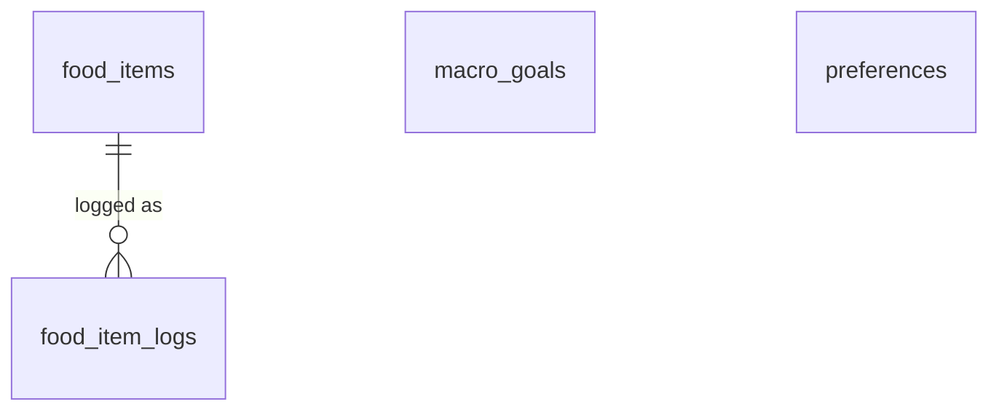

# Nutrition Module (`nutrition` schema)

*Status: **implemented** in `db/migrations/20261025190000_nutrition__init.sql` (`food_items`, `food_item_logs`, `macro_goals`, `preferences`), with food values widened to 6 decimal places in `db/migrations/20261026001500_nutrition__more_precision.sql`. Every table and column below is built. See [db-overview.md](db-overview.md) for conventions (audit columns, soft deletes, RLS) that apply to every table below. The API is in [api-overview.md](../api/api-overview.md) §7.2 and the screens in [nutrition-ui.md](../ui/nutrition-ui.md).*

**Replaces:** the Google Sheet food repo plus its daily log tab.

---

## 1. What the module does

- **Food repo:** a reusable list of the user's foods. Each food has a name, an optional description and a **standard quantity** (`100 g`, `1 tbsp`, `1 egg`), and its nutrition facts are **per one standard quantity**.
- **Food log:** each entry records *which food, how many standard quantities ("servings"), which day*, plus optional notes. 1.2 servings of a food whose standard is 100 g is 120 g.
- **Daily sheet:** a day's entries and the day's total of each nutrient, computed live from the log joined to the repo (never stored).
- **Eleven nutrients**, in a US nutrition label's order: calories, protein, total fat, saturated fat, trans fat, cholesterol, sodium, total carbs, fiber, total sugars, added sugars.
- **Tracked nutrients:** each user picks which nutrients they care about (Settings). Only tracked nutrients are shown anywhere; the rest are still stored if entered. Default: calories, protein, saturated fat, sodium and added sugars.
- **Unknown is not zero.** A food can leave any nutrient blank (NULL = unknown). Day totals add up the known values and say **which foods were missing a value**, rather than silently counting them as 0.
- **Macro goals:** per nutrient, a daily **target** (reach at least, e.g. 150 g protein) and/or a daily **limit** (stay under, e.g. 1,750 mg sodium). Goals are **effective-dated**: changing one doesn't rewrite the goals past days had.

---

## 2. Entity diagram

(Every table also has `user_id → core.users`, omitted for readability. `macro_goals` and `preferences` stand alone: goals are matched to a day by date, not by a foreign key, and `preferences` is one row per user.)

### Changes from the planning draft
- **No unit conversion.** The draft logged a `quantity` + `unit` ("150 g", "2 cups") and resolved it to servings through `serving_size` / `serving_grams`. Built: every entry is just a multiple of the food's standard quantity (`servings`), and the UI shows the resulting amount ("1.2 × 100 g = 120 g"). So `quantity`, `unit` and `serving_grams` are gone, and `serving_size` / `serving_unit` became `standard_quantity` / `standard_unit`.
- **Dropped from `food_items`:** `brand` (put it in the name or the description), `source` / `source_ref`, `is_favorite` (the log picker shows recently logged foods instead) and `notes` (now `description`).
- **Dropped from `food_item_logs`:** `meal` and `eaten_at`. An entry belongs to a day (`eaten_on`); entries within a day are listed in the order they were logged.
- **Nutrients are all nullable** and there are eleven of them (the full label set) instead of four required macros plus three optional ones. `carbs_g` / `fat_g` / `sugar_g` became `total_carbs_g` / `total_fat_g` / `total_sugars_g`.
- **Goals are one row per nutrient and kind**, with `starts_on` / `ends_on`, instead of one row per effective date holding every macro. That allows a target *and* a limit for the same nutrient, and lets each goal change independently.
- **Added `preferences`** for the tracked nutrients.

---

## 3. Tables

### `food_items`
The food repo. All nutrient values are **per one standard quantity**.

| Column | Type | Null | Notes |
|---|---|---|---|
| `id`, `user_id` | `uuid` | no | |
| `name` | `text` | no | Non-blank. "Broccoli", "Kirkland Greek yogurt". Unique per user, case-insensitive, among undeleted foods (below). API cap 100 chars; trimmed. |
| `description` | `text` | yes | Optional, e.g. "Steamed, from frozen". API cap 500 chars. |
| `standard_quantity` | `numeric(16,6)` | no | `> 0`. The amount the nutrients are for: the `100` in "100 g". |
| `standard_unit` | `text` | no | Non-blank free text: `g`, `oz`, `tbsp`, `egg`... API cap 30 chars; trimmed. The UI suggests common units. |
| `calories` | `numeric(16,6)` | yes | kcal. `>= 0`. |
| `protein_g` | `numeric(16,6)` | yes | |
| `total_fat_g` | `numeric(16,6)` | yes | |
| `saturated_fat_g` | `numeric(16,6)` | yes | |
| `trans_fat_g` | `numeric(16,6)` | yes | |
| `cholesterol_mg` | `numeric(16,6)` | yes | |
| `sodium_mg` | `numeric(16,6)` | yes | |
| `total_carbs_g` | `numeric(16,6)` | yes | |
| `fiber_g` | `numeric(16,6)` | yes | |
| `total_sugars_g` | `numeric(16,6)` | yes | |
| `added_sugars_g` | `numeric(16,6)` | yes | |

- Every nutrient column is **NULL = unknown** (never treated as 0) with `CHECK (... >= 0)`. The column suffix is the unit (`_g`, `_mg`; calories are kcal).
- `standard_quantity` and the nutrients keep **6 decimal places** (`numeric(16,6)`), since values are often derived (per oz from a per-serving label).
- Name uniqueness is a partial unique index `food_items_name_key` on `(user_id, lower(name)) WHERE deleted_at IS NULL`; the API returns **409** on a duplicate. A deleted food's name can be reused.
- Unique `(id, user_id)`: target of `food_item_logs`' composite FK.
- **Editing a food updates history.** Past days that logged it are recalculated with the new values; foods aren't versioned.
- **Deleting is soft.** A deleted food disappears from the repo and can't be logged again, but days that logged it keep showing it (and counting it).

### `food_item_logs`
One row per thing eaten.

| Column | Type | Null | Notes |
|---|---|---|---|
| `id`, `user_id` | `uuid` | no | |
| `food_item_id` | `uuid` | no | → `food_items`. Can't be changed after logging (log a new entry instead). |
| `eaten_on` | `date` | no | The day it counts toward, in the user's timezone. Editable. |
| `servings` | `numeric(16,6)` | no | `> 0`. Up to 6 decimal places. Multiples of the food's standard quantity: 1.2 × (100 g) = 120 g. |
| `notes` | `text` | yes | API cap 500 chars. |

- `FOREIGN KEY (food_item_id, user_id) REFERENCES food_items (id, user_id)` (`food_item_logs_food_item_id_user_id_fkey`). It points at soft-deleted foods too, which is how past days keep them. **Logging a deleted food is refused by the API** (the insert only selects undeleted foods, so it's a 404), since the FK alone would accept it.
- Partial index `food_item_logs_user_day_idx` on `(user_id, eaten_on DESC) WHERE deleted_at IS NULL` for a day's sheet and the history list; plain index `food_item_logs_food_idx` on `food_item_id` for a food's "last logged" date.
- Deleting an entry is a soft delete.

### `macro_goals`
Daily targets and limits, one row per nutrient, kind and stretch of time.

| Column | Type | Null | Notes |
|---|---|---|---|
| `id`, `user_id` | `uuid` | no | |
| `nutrient` | `text` | no | `CHECK IN` the eleven nutrient keys (the `food_items` column names, e.g. `protein_g`). |
| `kind` | `text` | no | `CHECK IN ('target','limit')`. Target: reach at least. Limit: stay under. |
| `amount` | `numeric(10,2)` | no | `> 0`, in the nutrient's unit. Stays at 2 places on purpose: goals are round numbers the user types. |
| `starts_on` | `date` | no | First day it applies (the user's "today" when it was created). |
| `ends_on` | `date` | yes | Last day it applies, inclusive. NULL = still active. `CHECK (ends_on IS NULL OR ends_on >= starts_on)`. |

- **One active goal of each kind per nutrient:** partial unique index `macro_goals_active_key` on `(user_id, nutrient, kind) WHERE ends_on IS NULL AND deleted_at IS NULL`. A calorie target and a calorie limit can coexist; a second calorie target is a **409**.
- A goal **applies to day D** when `starts_on <= D` and (`ends_on` is NULL or `ends_on >= D`), and it isn't deleted.
- Goals can be set for any nutrient, tracked or not.
- How creating, changing and removing goals keeps history is in §4.

### `preferences`
One row per user: which nutrients they track.

| Column | Type | Null | Notes |
|---|---|---|---|
| `id`, `user_id` | `uuid` | no | `user_id` is unique (one row per user). |
| `tracked_nutrients` | `text[]` | no | Nutrient keys. `CHECK (tracked_nutrients <@ ARRAY[...the eleven keys...])`. May be empty. |

- **Display order is the app's nutrient order** (§1), not the array's. The API de-duplicates and returns it in display order.
- **No `deleted_at`**: an exception to the soft-delete convention. The row is only ever upserted (`ON CONFLICT (user_id) DO UPDATE`), never deleted.
- **Seeded on first enable:** the module's `setup` (`api/app/modules/nutrition/__init__.py`) writes the default tracked set (`DEFAULT_TRACKED` in `service.py`: calories, protein, saturated fat, sodium, added sugars) the first time the user turns Nutrition on. If the row is somehow missing, `GET /nutrition/preferences` returns the defaults.

### 3.1 Integrity, RLS and grants

- All four tables have the `set_updated_at` trigger, RLS enabled and an `owner` policy (`user_id = core.current_user_id()`, for `USING` and `WITH CHECK`) for `disci_app`.
- The migration grants `USAGE` on the schema and `SELECT, INSERT, UPDATE, DELETE` on its tables to `disci_app`, plus default privileges for tables created later.
- The only child FK is `food_item_logs → food_items`, which includes `user_id` (tenant guard, see [db-overview.md](db-overview.md) §2). A user can't log another user's food: RLS hides it, so it's a 404.

### 3.2 Delete behavior

| Deleting | What happens |
|---|---|
| A food | Soft-deleted. Gone from the repo and the log picker; can't be logged again. Past entries keep it (the API marks them `food_deleted`) and still count it. Its name can be reused. |
| A log entry | Soft-deleted. |
| A goal | If it **started today**: soft-deleted (it never applied to an earlier day). Otherwise: **ended yesterday** (`ends_on`), so it still covers the days it applied to. |

---

## 4. How the features map to the tables

| Feature | How |
|---|---|
| **Nutrient registry** | `NUTRIENTS` in `api/app/modules/nutrition/service.py`: key (= `food_items` column), label and unit, in display order. The same eleven keys are in the migration's CHECKs and the `NutrientKey` type in `schemas.py`; adding a nutrient means a migration plus those two. |
| **An entry's nutrients** | `service.entry_nutrients`: each of the food's per-standard values × `servings`, rounded to 6 decimal places (`PRECISION`). NULL stays NULL. Computed on read, so editing a food changes past days. |
| **Day totals** | `service.day_totals`, per nutrient over the day's entries: `amount` = sum of the **known** values; `missing_foods` = names of the foods logged that day with no value (sorted, case-insensitive). `amount` is NULL when entries exist but **none** has a value; a day with **no entries** totals 0 (`"0.000000"`). Totals are returned for all eleven nutrients; the web app shows the tracked ones. |
| **Daily sheet** | `GET /nutrition/days/{date}`: the day's undeleted entries (oldest logged first) joined to their food (deleted or not), plus totals. |
| **History** | `GET /nutrition/days`: distinct `eaten_on` with undeleted entries, newest first, paged by a `before` date cursor (`queries/list_logged_days.sql`), each with its entry count and totals. |
| **Recent foods** | Each food's `last_logged_on` = latest `eaten_on` among its undeleted entries (a subquery in `list_foods.sql`). The log picker shows the five most recent. |
| **Goals on a day** | `GET /nutrition/goals?on=<date>` (default today in the user's timezone): rows whose `starts_on`..`ends_on` covers the day, targets first. |
| **Creating a goal** | Inserts a row with `starts_on` = today in the user's timezone. |
| **Changing a goal's amount** | If it **started today**: updated in place. Otherwise the old row gets `ends_on` = yesterday and a **new row** (new id) starts today with the new amount, so earlier days keep the old amount. Only active goals (`ends_on` NULL) can be changed; nutrient and kind can't. |
| **Removing a goal** | Soft-delete if it started today, else end it yesterday (§3.2). |

Goals aren't compared with day totals anywhere yet (see §6).

---

## 5. Decisions

| Question | Decision |
|---|---|
| How are quantities entered? | **Multiples of the food's standard quantity** (`servings`). No unit conversion: a food logged by weight gets a weight standard (`100 g`), a countable one a count (`1 egg`). |
| How precise are food values? | **6 decimal places** for `standard_quantity`, the nutrients and `servings` (`numeric(16,6)`), so derived values (per oz from a per-serving label) aren't rounded away. Entry nutrients are rounded to 6 places and totals sum those. Goals stay `numeric(10,2)`. Display still rounds (nutrients to 1 decimal, quantities to 3). |
| Which nutrients? | The **eleven** on a US label (§1). Each user picks which to track; only those are shown. |
| A nutrient the label doesn't give? | **NULL = unknown, never 0.** Totals sum what's known and list the foods missing a value. |
| Editing a food's nutrition? | **Updates history (v1).** Past days are recalculated. Versioning would mean an edit creates a new row and soft-deletes the old one. |
| Deleting a food that was logged? | **Soft delete**; past days keep it, it can't be logged again, the name is free to reuse. |
| Change the food on a log entry? | **No.** Delete the entry and log the other food. Servings, day and notes are editable. |
| Goal shape | **One row per nutrient + kind** (`target` = reach at least, `limit` = stay under), at most one active of each. |
| Goals over time | **Effective-dated** (`starts_on` / `ends_on`). Changes start today; past days keep the goals they had. |
| Do goals vary by day (training vs. rest)? | **No, not in v1.** |

## 6. Open questions

1. **Goals vs. the day:** goals aren't shown on the daily sheet yet. The plan is a later dashboard combining them with day totals (progress toward targets, warnings near limits).
2. **Meals:** group entries into breakfast / lunch / dinner / snack? Dropped for v1; would be a nullable `meal` column on `food_item_logs`.
3. **Recipes or saved meals** ("my usual breakfast" = several foods logged at once): a future `recipes` + `recipe_items` pair.
4. **Versioning foods**, if recalculating history on edit turns out to be wrong (§5).
5. **Day-dependent goals** (training vs. rest days) would need a day-type dimension on `macro_goals`.
6. **Other logs:** body weight, water intake.
7. **Importing the food repo** from the Google Sheet, and **Claude/MCP logging** ("I had an apple": look up the food by name, propose nutrients if missing, then log it).
