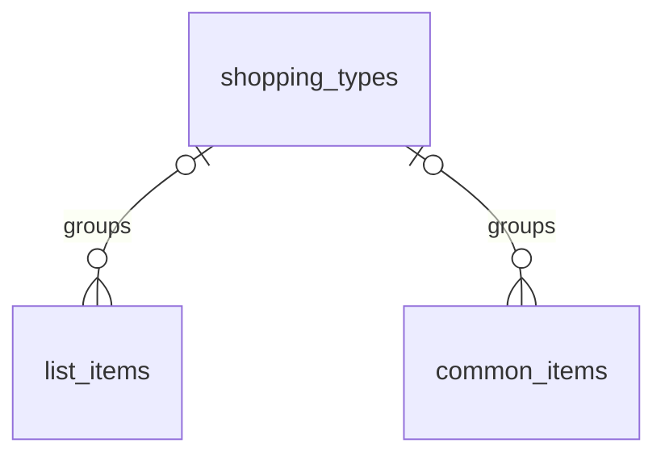

# Shopping List Module (`shopping` schema)

*Status: **implemented** (`shopping_types`, `list_items`, `common_items`). Every table and column below is built. See [db-overview.md](db-overview.md) for conventions (audit columns, soft deletes, RLS) that apply to every table below. The API is in [api-overview.md](../api/api-overview.md) §7.4 and the screens in [shopping-ui.md](../ui/shopping-ui.md).*

**Replaces:** the notes-app grocery list (and the separate lists for other stores).

---

## 1. What the module does

- The user shops by **types** they define themselves: a kind of shopping ("Groceries", "Clothing") or a store ("Kroger", "Trader Joe's"). Every list item and common item belongs to one type, or to none (**Uncategorized**).
- The **shopping list** is what to buy now. Items are **crossed off** while shopping and stay on the list, crossed off, until they're **removed** (one at a time, or "clear crossed off").
- **Common items** are things bought often. Adding one puts a **copy** of it on the list in one tap.

---

## 2. Entity diagram

(Every table also has `user_id → core.users`, omitted for readability. There is deliberately no link between `list_items` and `common_items`; see §5.)

---

## 3. Tables

### `shopping_types`
The user's kinds of shopping.

| Column | Type | Null | Notes |
|---|---|---|---|
| `id`, `user_id` | `uuid` | no | |
| `name` | `text` | no | Non-blank (`CHECK (length(trim(name)) > 0)`). API cap 100 chars; trimmed. Unique per user, case-insensitively, among undeleted types (partial unique index `shopping_types_user_name` on `(user_id, lower(name))`). |
| `sort_order` | `integer` | no | Order of the cards on the list. New types go last (`max + 1`). |

- Unique `(id, user_id)`: target of both child tables' composite FKs.
- Soft-deleted (`deleted_at`).

### `list_items`
What's on the list now, crossed off or not.

| Column | Type | Null | Notes |
|---|---|---|---|
| `id`, `user_id` | `uuid` | no | |
| `shopping_type_id` | `uuid` | yes | → `shopping_types`. Null = Uncategorized. |
| `name` | `text` | no | Non-blank. API cap 200 chars; trimmed. Not unique. |
| `notes` | `text` | yes | Optional detail ("2 lbs", "size 10"). API cap 300 chars; blank becomes null. |
| `sort_order` | `integer` | no | Order within its type (§4). |
| `done_at` | `timestamptz` | yes | Set = **crossed off**. Keeps the first time it was crossed off. |

- `FOREIGN KEY (shopping_type_id, user_id) REFERENCES shopping_types (id, user_id)`.
- Index `list_items_user_idx` on `(user_id)`.
- **No `deleted_at`**: removing an item deletes the row (§3.2).

### `common_items`
Things bought often, ready to add to the list.

| Column | Type | Null | Notes |
|---|---|---|---|
| `id`, `user_id` | `uuid` | no | |
| `shopping_type_id` | `uuid` | yes | → `shopping_types`. Null = Uncategorized. |
| `name` | `text` | no | Non-blank. API cap 200 chars; trimmed. |
| `notes` | `text` | yes | Copied onto the list with the item. API cap 300 chars. |

- `FOREIGN KEY (shopping_type_id, user_id) REFERENCES shopping_types (id, user_id)`.
- **One per name per type**: partial unique index `common_items_user_type_name` on `(user_id, shopping_type_id, lower(name)) NULLS NOT DISTINCT WHERE deleted_at IS NULL`. `NULLS NOT DISTINCT` makes Uncategorized count as a type, so there's only one Uncategorized "Eggs" too.
- Soft-deleted (`deleted_at`).

### 3.1 Integrity, RLS and grants

- All three tables have the `set_updated_at` trigger, RLS enabled and an `owner` policy (`user_id = core.current_user_id()`, for `USING` and `WITH CHECK`) for `disci_app`.
- The migration grants `USAGE` on the schema and `SELECT, INSERT, UPDATE, DELETE` on its tables to `disci_app`, plus default privileges for tables created later.
- Both child FKs include `user_id` (tenant guard, see [db-overview.md](db-overview.md) §2). The API also checks that a given type exists and isn't deleted (a 422 otherwise), since the FK alone would accept a soft-deleted type.
- **Seeded default:** the module's `setup` creates one type, **Groceries**, the first time the user enables Shopping list (`DEFAULT_TYPES` in `api/app/modules/shopping/__init__.py`).

### 3.2 Delete behavior

| Deleting | What happens |
|---|---|
| A type | Soft-deleted. Its list items and common items become **Uncategorized** (`queries/uncategorize.sql`); its list items keep their order and go after the items already in Uncategorized. |
| A list item | **Hard-deleted**, an exception to the soft-delete convention. A crossed-off item is kept on the list until removed; once removed there's nothing worth keeping. "Clear crossed off" deletes every crossed-off item in one type, or in all types. |
| A common item | Soft-deleted. The list isn't affected (list items are copies). |

---

## 4. How the features map to the tables

| Feature | How |
|---|---|
| **Cross off / put back** | Set `done_at` (keeping an earlier one if already set) / clear it. The item stays on the list either way. |
| **Clear crossed off** | `DELETE` the rows with `done_at` set, in one type (null = Uncategorized) or all types. |
| **On list** (common items) | Computed, not stored: a common item is `on_list` when an item with the **same name (case-insensitive) and type** is on the list and **not crossed off** (`list_common.sql`). |
| **Add a common item to the list** | Copies its name, type and notes into a new `list_items` row; **no link is kept**. If a matching open item (same name, any case, same type, not crossed off) is already on the list, that item is returned instead of adding a duplicate (`find_open_item.sql`). |
| **Save as common** | Adding a list item with `save_as_common` also inserts a common item with the same name, type and notes, unless one already exists (`ON CONFLICT DO NOTHING`). Saving an existing list item from the app creates the common item directly (a 409 when it already exists). |
| **Order of types** | `shopping_types.sort_order`, one sequence per user. Reorder sets each type's `sort_order` to its position in the list sent. |
| **Order of items** | `list_items.sort_order`, then `created_at`. A new item goes **last in its type** (`max + 1` among that type's items). Moving an item to another type puts it last there. Reorder sets each item's `sort_order` to its position in the list sent (the app sends every item). |
| **Common items' order** | By name, case-insensitively. |

---

## 5. Decisions

| Question | Decision |
|---|---|
| Fixed types or user-defined? | **User-defined.** People split shopping differently (by kind, by store), and types behave identically in code, so they're rows the user adds, renames, reorders and deletes. |
| Soft- or hard-delete list items? | **Hard delete.** Crossed-off items already stay visible until removed; after that there's no history worth keeping. |
| Link a list item to the common item it came from? | **No** (the user's choice). Adding a common item copies its name, type and notes. Editing or deleting either one never affects the other, and "on list" is a name + type match. |
| Common items unique? | **One per name per type**, case-insensitively, with **Uncategorized counted as a type** (`NULLS NOT DISTINCT`). The same name in two types is fine ("Milk" at Kroger and at Costco). |
| How is "crossed off" stored? | **`done_at` timestamp**, not a boolean: it records when, and the API derives `done` from it. |
| Starting types | **One, "Groceries"**, seeded the first time the module is enabled. Everything else the user adds. |
| Notes | **Optional** on list items and common items, for quantity or detail ("2 lbs", "the blue one"). |

## 6. Not built yet

See [roadmap.md](../roadmap.md).
