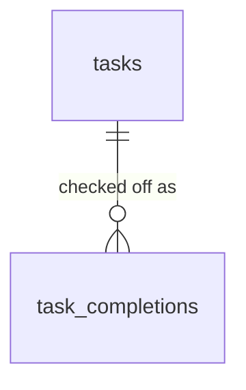

# Tasks Module (`tasks` schema)

*Status: **implemented** in `db/migrations/20261027120000_tasks__init.sql` (`tasks`, `task_completions`). Every table and column below is built. See [db-overview.md](db-overview.md) for conventions (audit columns, soft deletes, RLS) that apply to every table below. The API is in [api-overview.md](../api/api-overview.md) §7.3 and the screens in [tasks-ui.md](../ui/tasks-ui.md).*

**Replaces:** the Google Sheet task log (daily habits, recurring upkeep and one-off to-dos).

---

## 1. What the module does

Every task is one of **four fixed types**. The type decides which columns it uses and how checking it off behaves, so types are code, not user-editable rows.

| Type (`task_type`) | Shown as | What it is | Examples |
|---|---|---|---|
| **`daily_checklist`** | Daily checklist | A habit to do **every day**, once or several times. It has a **daily target** (1 for "take my pill", 5 for "5 sets of jaw exercises"). Each day starts at **zero**: yesterday's count has no bearing on today. | "Take cholesterol pill", "Fill the Brita before bed", "5 sets of jaw exercises" |
| **`nondaily_maintenance`** | Maintenance | Upkeep that comes back **roughly every X days, weeks, months, quarters or years**. Checking it off moves its **next due** date to that long **after the day it was done**, so doing it late pushes the next one out. Editing the next due date snoozes it. | "Wash the bedsheets every 2 weeks", "Replace the HVAC filter every quarter" |
| **`adhoc_to_do`** | To-do | A **one-time** task, with or without a due date. Checked off once, it's done; it stays on today's list, crossed off, until the day ends, and is kept in history. | "Book flights for Christmas", "Return *Black Wave* to the library by Nov 1" |
| **`keep_in_mind`** | Keep in mind | An **evergreen reminder**: no due date, nothing to check off. It's simply shown, to stay front of mind. | "Remember to say please", "Read more" |

The user-facing text for each type (name, summary, how it works, examples) lives once, in `TASK_TYPES` in `api/app/modules/tasks/service.py`, and is served by `GET /tasks/types`.

---

## 2. Entity diagram

(Both tables also have `user_id → core.users`, omitted for readability.)

### Changes from the planning draft
The first draft (two types, `adhoc` and `maintenance`, scheduled by RRULE strings and expanded into a `task_occurrences` table by a nightly job) was replaced before anything was built:

- **Four types instead of two:** a daily habit with a target count became its own type (`daily_checklist`), and `keep_in_mind` was added. "Strict schedule" maintenance (Brita every night) is now a daily checklist item.
- **Explicit columns instead of RRULE:** `repeat_every` + `repeat_unit` (like finance's explicit schedule columns), with no parser.
- **No occurrences, no generation job:** instead of pre-creating a row per due instance, a task holds its own `next_due` and every check-off is logged in **`task_completions`**. There is nothing to generate, miss or skip.
- **Progress isn't a column on the task.** The planning notes had a `complete_tally` on each task; it's counted from `task_completions` instead (§5). The notes' `repeats` flag is implied by the type, and their `complete_threshold` became `daily_target` (daily checklist only).
- **Dropped:** `due_time`, `starts_on` / `ends_on`, `paused_at`, skip / missed statuses and per-instance notes.

---

## 3. Tables

### `tasks`
One row per task. Which of the optional columns apply depends on `task_type` (CHECKs below).

| Column | Type | Null | Notes |
|---|---|---|---|
| `id`, `user_id` | `uuid` | no | |
| `task_type` | `text` | no | `CHECK IN ('daily_checklist','nondaily_maintenance','adhoc_to_do','keep_in_mind')`. **Can't change** after creation (the API's update leaves it out). |
| `name` | `text` | no | Non-blank (`CHECK (length(trim(name)) > 0)`). API cap 200 chars; trimmed. Not unique. |
| `description` | `text` | yes | API cap 1,000 chars. |
| `repeat_every` | `integer` | yes | Maintenance only: how many `repeat_unit`s apart. `> 0`; API cap 1,000. |
| `repeat_unit` | `text` | yes | Maintenance only. `CHECK IN ('day','week','month','quarter','year')`. |
| `next_due` | `date` | yes | **Maintenance:** when it's next due (required; moved forward by each check-off, editable to snooze; the API defaults it to today on create). **To-do:** its optional due date (a check-off doesn't change it). Null for the other types. |
| `daily_target` | `integer` | yes | Daily checklist only (required): check-offs a day needs to be done. `> 0`; API cap 100; the API defaults it to 1. |

- **Generic rule:** `CHECK ((repeat_every IS NULL) = (repeat_unit IS NULL))`.
- **One CHECK per type**, each of the form `task_type <> 'x' OR (...)`, so adding a type never rewrites the others:

| Type | Must be set | Must be null |
|---|---|---|
| `daily_checklist` | `daily_target` | `repeat_every` (so `repeat_unit`), `next_due` |
| `nondaily_maintenance` | `repeat_every` (so `repeat_unit`), `next_due` | `daily_target` |
| `adhoc_to_do` | (nothing; `next_due` optional) | `repeat_every`, `daily_target` |
| `keep_in_mind` | (nothing) | `repeat_every`, `next_due`, `daily_target` |

- **The API clears rather than rejects** fields a type doesn't use (`service.type_fields`), so a form can send everything it has; a field the type *requires* but is missing is a 422 ("nondaily_maintenance tasks need repeat_every, repeat_unit").
- Unique `(id, user_id)`: target of `task_completions`' composite FK.
- Partial index `tasks_user_idx` on `(user_id) WHERE deleted_at IS NULL`.

### `task_completions`
One row per check-off. This is where all progress lives.

| Column | Type | Null | Notes |
|---|---|---|---|
| `id`, `user_id` | `uuid` | no | |
| `task_id` | `uuid` | no | → `tasks` |
| `completed_on` | `date` | no | The day it counts toward, in the user's timezone. Defaults to today; can be a past day, never a future one (API 422). |
| `due_on` | `date` | yes | The task's `next_due` at the moment it was checked off. For maintenance this is what **undo restores**; for to-dos it records when it was due. Null for daily checklist items. |

- `FOREIGN KEY (task_id, user_id) REFERENCES tasks (id, user_id)`.
- Partial index `task_completions_task_idx` on `(task_id, completed_on DESC) WHERE deleted_at IS NULL` (a task's latest check-off, today's count, recent history); partial index `task_completions_user_day_idx` on `(user_id, completed_on) WHERE deleted_at IS NULL` (everything done on a day).
- **Undo soft-deletes** the row (`deleted_at`); rows are never edited.
- Several rows on the same day are normal (a daily target of 5 is five rows).

### 3.1 Integrity, RLS and grants

- Both tables have the `set_updated_at` trigger, RLS enabled and an `owner` policy (`user_id = core.current_user_id()`, for `USING` and `WITH CHECK`) for `disci_app`.
- The migration grants `USAGE` on the schema and `SELECT, INSERT, UPDATE, DELETE` on its tables to `disci_app`, plus default privileges for tables created later.
- The only child FK, `task_completions → tasks`, includes `user_id` (tenant guard, see [db-overview.md](db-overview.md) §2). Another user's task is invisible under RLS, so checking it off is a 404.
- **Concurrent check-offs** of one task are serialized: complete and undo first lock the task row (`queries/lock_task.sql`, `SELECT ... FOR UPDATE`), so two taps can't both see a to-do as open or both move a maintenance date.
- Nothing is seeded: the module has no `setup`.

### 3.2 Delete behavior

| Deleting | What happens |
|---|---|
| A task | Soft-deleted. It leaves every list and its own `GET` is a 404, but **its completions stay**: they're history, and "what got done on a day" (`GET /tasks/completions`) still lists them under the task's name. |
| A check-off (undo) | Soft-deleted (§4). |

---

## 4. How the features map to the tables

| Feature | How |
|---|---|
| **A task's progress on day D** | `list_tasks.sql` / `get_task.sql` join each task to a lateral count over its undeleted completions: `done_on_day` = check-offs with `completed_on = D`, `last_done_on` = the latest `completed_on`. `service.progress` then works out `done` and the due status. |
| **`done`, per type** | Daily: `done_on_day >= daily_target`. Maintenance: `last_done_on = D` (done that day; it's already due again later). To-do: it has any check-off. Keep in mind: always false. |
| **Due status** | `service.due_status(next_due, D)`: `overdue` when `next_due < D`, `due_today` when equal, `upcoming` after; `days_until_due` is negative when overdue. Null without a `next_due`, and **a finished to-do has none** (done isn't overdue). There's **no grace period**: a maintenance task is overdue the day after its due date. The UI words it gently instead ("2 days past due", in amber, not red). |
| **Listing tasks** | Undeleted tasks, soonest `next_due` first (no due date last), then by name. **To-dos finished before D are left out**; one finished on D stays in the list (with `done`), so it shows crossed off **until the day ends** and is gone tomorrow. |
| **Check off: daily checklist** | Insert a completion for D. Each one adds 1 to the day's count; going **past the target** is allowed. |
| **Check off: maintenance** | Insert a completion (with `due_on` = the current `next_due`), then set `next_due` = **D + interval** (`service.add_interval`). Counting from the day it was done, not the old due date, is what makes "roughly every 2 weeks" squishy: done late, the next one moves out. A check-off for a past day counts from that day. |
| **Check off: to-do** | Insert one completion. A second one is a **409** ("already done"). `next_due` is left as it was. |
| **Check off: keep in mind** | Refused (**422**): nothing to check off. |
| **Undo: daily checklist** | Soft-delete the **latest check-off on D** (default today). Earlier days are untouched; with none left on D, undo is a 404. |
| **Undo: maintenance** | Soft-delete the latest check-off (any day) and put `next_due` back to its `due_on`. |
| **Undo: to-do** | Soft-delete its check-off; it's open again (and back on the list on later days). |
| **Edit a task** | Replace name, description and the type's own fields; the type can't change. Moving a maintenance `next_due` is how you snooze it. Past completions are unaffected. |
| **What got done on a day** | `list_completions_on.sql`: every undeleted completion with `completed_on = D`, oldest first, joined to its task (deleted tasks included: it still happened). |
| **A task's history** | `GET /tasks/{id}` returns its latest 30 completions, newest first. |

### 4.1 Interval maths (`service.add_interval`)

| `repeat_unit` | Adds | Example |
|---|---|---|
| `day` | `repeat_every` days | Oct 27 + 3 days = Oct 30 |
| `week` | `repeat_every` × 7 days | Oct 27 + 2 weeks = Nov 10 |
| `month` | `repeat_every` **calendar months** | Dec 15, 2026 + 13 months = Jan 15, 2028 |
| `quarter` | `repeat_every` × 3 calendar months | Nov 30 + 1 quarter = **Feb 28** |
| `year` | `repeat_every` × 12 calendar months | Feb 29, 2024 + 1 year = **Feb 28**, 2025 |

Months keep the day of the month; a day that doesn't exist in the target month **clamps to its last day** (Jan 31 + 1 month = Feb 28). Each round counts from the day it was actually done, so a clamped date doesn't snap back: done on Feb 28, a monthly task is next due Mar 28.

---

## 5. Decisions

| Question | Decision |
|---|---|
| Fixed types or user-defined? | **Fixed** (four), because each behaves differently in code. A Kinds page in the app explains them. Adding one = a migration (extend the type CHECK, add its own CHECK) plus its behavior in `service.py` and the routes. |
| One table for all types? | **Yes.** Columns a type doesn't use are null, enforced per type by CHECKs (§3). |
| Where does progress live? | **In `task_completions`, never on the task.** A tally column would need a **daily reset job** at each user's midnight (and would be wrong for anyone the job missed). Counting rows by `completed_on` means a new day simply starts at zero. It also **keeps history** (what got done when, which a tally overwrites) and makes **undo simple**: soft-delete the latest row, and for maintenance restore the `due_on` it recorded. |
| Recurrence format | **`repeat_every` + `repeat_unit`** (day, week, month, quarter, year), not RRULE. Easy to CHECK and to edit in a form. |
| Next due counts from? | **The day it was done** (completion basis), not the old due date. |
| Grace period before overdue? | **None.** Overdue the day after it's due, but labelled gently ("N days past due", amber). |
| Finished to-dos | Stay on **that day's** list, crossed off, then drop off. Kept in history. |
| Can a daily item go past its target? | **Yes** (5 of 3 is fine); it counts as done once it reaches the target. |
| Check off a past day? | **Yes** in the API (`on`), never a future day. The web app only checks off today for now. |
| Change a task's type? | **No.** Delete it and add a new one. |
| Deleting a task | **Soft delete**; its completions stay as history. |

## 6. Open questions / later

1. **Visualizations:** better ways to see tasks and progress (streaks, history, calendars). The user will send inspiration.
2. **MCP tools for tasks** ("I did my jaw exercises", "what's due today?", "add a to-do"). The endpoints exist; see [mcp-overview.md](../mcp/mcp-overview.md).
3. **Reordering** tasks within a list (today: soonest due, then name). Would be a `sort_order` column like finance's.
4. **Morning / night reports** (due today and overdue; what got done today) can read straight from `GET /tasks` and `GET /tasks/completions`.
5. **Categories, priority or subtasks:** none planned yet.
6. **Importing** the current task list from the Google Sheet.
