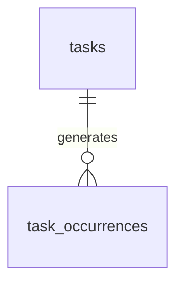

# Tasks Module (`tasks` schema)

*Status: planning draft. See [db-overview.md](db-overview.md) for conventions (audit columns, soft deletes, RLS) that apply to every table below.*

**Replaces:** the Google Sheet task log (recurring checklist tasks plus ad-hoc to-dos).

---

## 1. What the module does

Every task has a **task type**, and the type decides how the task behaves. **More types will be added later.** The two below are the first ones, not a closed set:

| Type | What it is | Examples |
|---|---|---|
| **`adhoc`** | A one-off to-do. In the old sheet it was deleted once done. Here it's **marked done instead** (complete, don't delete). | "Book a flight for the wedding" |
| **`maintenance`** | Regular upkeep you should do **roughly every X days, weeks or months**. Done is never final, because it always comes back. | "Wash bedsheets" every ~2 weeks, "Refill the Brita" nightly, "Replace HVAC filter" every ~3 months |

Further behavior, inferred from the inspiration doc (marked ✱):

- ✱ **Ad-hoc tasks** have an optional due date (or none, for "someday"). Once done, they drop off the active list but keep their `completed_at` for history and the night report.
- ✱ **Checking off a maintenance task completes this round, not the task.** The next round is scheduled automatically.
- ✱ **Maintenance cadence is "roughly"** by default: the next round is due X weeks **after you last did it**, so doing it late pushes the next one out. Strictly scheduled tasks (Brita *every* night) are also supported.
- ✱ **Skip** a round ("not refilling the Brita tonight, I'm traveling") without counting it as done.
- ✱ **Missed strict rounds don't pile up.** An unchecked Brita refill from last night is marked *missed*, not left overdue forever. Ad-hoc tasks *do* stay overdue until done.
- ✱ **Morning report:** due today, plus anything overdue. **Night report:** what was completed today, plus what's still open.

---

## 2. Entity diagram

(Both tables also have `user_id → core.users`, omitted for readability.)

### Changes from the brainstorm notes
- **"Task types" is a column, not a table (for now).** Each type drives different *code* behavior (scheduling, overdue handling), so types aren't user-editable rows. Adding a type is a small migration (extend the `CHECK` list and add any per-type constraint) plus the code that implements its behavior. If types later need their own metadata (labels, icons, default settings), promote this to a code-managed `task_types` lookup table. Categories or tags (Chores, Errands...) are a separate concept and could be added later.
- **Added `task_occurrences`.** A task is the **definition** ("refill the Brita, daily"), and each dated instance you can check off is an **occurrence**. Without this split, completing a maintenance task would mean either mutating the task (losing history) or cloning it (duplicating the definition). This follows principle #3 in the inspiration doc.
- **Ad-hoc tasks get exactly one occurrence.** Every checkable thing is then an occurrence, so "what's due today" and "what did I finish today" are each a single query, whatever the task's type.

---

## 3. Tables

### `tasks`
The definition of a task: what it is and, for maintenance tasks, its cadence.

| Column | Type | Null | Notes |
|---|---|---|---|
| `id`, `user_id` | `uuid` | no | |
| `task_type` | `text` | no | `CHECK IN ('adhoc','maintenance')` for now. Extended as new types are added. |
| `title` | `text` | no | |
| `notes` | `text` | yes | |
| `recurrence_rule` | `text` | yes | RRULE, e.g. `FREQ=DAILY`, `FREQ=WEEKLY;INTERVAL=2`, `FREQ=MONTHLY;INTERVAL=3`. Required for `maintenance`, NULL for `adhoc`. Future types declare their own requirement. |
| `recurrence_basis` | `text` | yes | `CHECK IN ('completion','schedule')`. Set exactly when `recurrence_rule` is set (the API defaults it to `'completion'` for maintenance). **completion**: next round due one interval after the last completion ("roughly every 2 weeks"). **schedule**: due on fixed dates regardless (Brita nightly). |
| `starts_on` | `date` | yes | First due date for a maintenance task. |
| `ends_on` | `date` | yes | Stop generating after this date. |
| `due_time` | `time` | yes | Optional time of day ("by 9pm"). Applies to every occurrence. |
| `paused_at` | `timestamptz` | yes | Paused maintenance tasks generate no new occurrences. |

- `CHECK ((recurrence_rule IS NULL) = (recurrence_basis IS NULL))`: a generic rule that holds for every type.
- `CHECK (task_type <> 'adhoc' OR recurrence_rule IS NULL)`
- `CHECK (task_type <> 'maintenance' OR recurrence_rule IS NOT NULL)`
- Each type gets its own `task_type <> 'x' OR ...` constraint like these, so adding a type never requires rewriting the others.

### `task_occurrences`
A single checkable instance of a task.

| Column | Type | Null | Notes |
|---|---|---|---|
| `id`, `user_id` | `uuid` | no | |
| `task_id` | `uuid` | no | → `tasks` |
| `due_on` | `date` | yes | NULL only for undated ("someday") ad-hoc tasks. For ad-hoc tasks, this is where the due date lives. |
| `status` | `text` | no | `CHECK IN ('open','done','skipped','missed')`, default `'open'`. |
| `completed_at` | `timestamptz` | yes | Set when `status = 'done'`. |
| `notes` | `text` | yes | Per-instance note ("used the new filter"). |

- Unique `(task_id, due_on)` where `due_on` is not null, which makes generation idempotent.
- `CHECK ((status = 'done') = (completed_at IS NOT NULL))`

---

## 4. How the features map to the tables

| Feature | How |
|---|---|
| **Create an ad-hoc task** | Insert `tasks` (`task_type = 'adhoc'`) and one `task_occurrences` row with the chosen `due_on` (or NULL). |
| **Finish an ad-hoc task** | Set its occurrence to `done` with `completed_at`. The active list hides it, and history and the night report still see it. |
| **Maintenance, completion basis** (default) | Only one open occurrence exists at a time. Completing (or skipping) it creates the next one, with `due_on` = completion date + interval. The UI can show "due in 3 days" or "5 days overdue". |
| **Maintenance, schedule basis** | A nightly job expands the RRULE and inserts `open` occurrences for a rolling window (e.g. the next 7 days), so "upcoming" and the morning report can see them. |
| **Missed handling** | Schedule basis only: the nightly job marks an `open` occurrence as `missed` once a newer occurrence of the same task is due. Completion-basis and ad-hoc occurrences are never auto-missed. They just become overdue. |
| **Due today** | `status = 'open' AND due_on <= today` (user's timezone). |
| **Night report** | `status = 'done' AND completed_at` falls within today (user's timezone), plus whatever is still open. |
| **Edit a maintenance cadence** | Update the rule, then delete (soft) future `open` occurrences and regenerate. Past ones stay as history. |

---

## 5. Open questions

1. **Additional task types:** more types are planned and will be defined later. Each needs its behavior described (does it recur? how is it scheduled? what does "overdue" mean?) and its constraint added.
2. **Priority, subtasks or categories/tags** for tasks? None are drafted.
3. **Should "roughly" have a grace window?** E.g. a 2-week task isn't flagged overdue until a few days past due. This could be an optional `grace_days` column on `tasks`.
4. **Current task list and cadences** from the task sheet, for seeding and migration.
