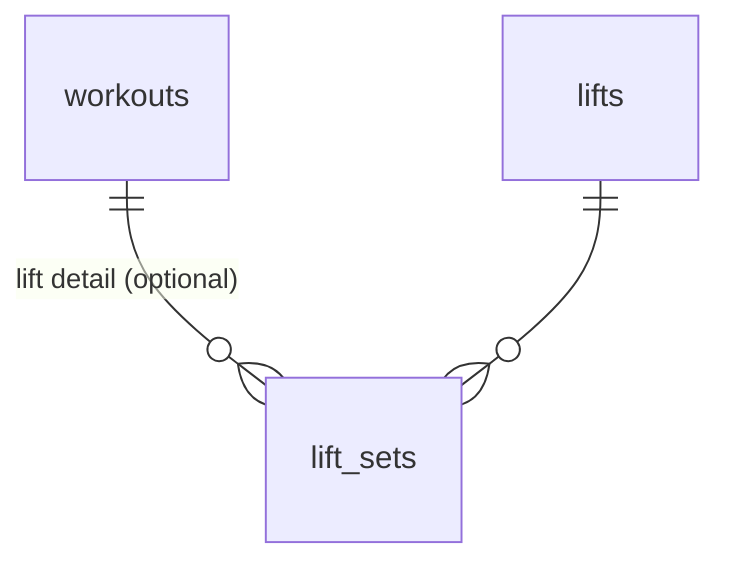

# Training Module (`training` schema)

*Status: **implemented** (`workouts`, `lifts`, `lift_sets`): the workout log. Every table and column below is built. Training plans are not built yet ([roadmap.md](../roadmap.md)). See [db-overview.md](db-overview.md) for conventions (audit columns, soft deletes, RLS) that apply to every table below. The API is in [api-overview.md](../api/api-overview.md) §7.5 and the screens in [training-ui.md](../ui/training-ui.md). The reasoning before the build is in [project_plans/training-module.md](../project_plans/training-module.md).*

**Replaces:** the separate Lifting module idea, which this module folds in.

---

## 1. What the module does

- The user logs **workouts**: a **run**, **walk**, **bike** ride or **lift** session. One row per session, with the fields that activity uses (miles, time, elevation, heart rate, location, description, reflection).
- A lift can carry **sets**: which lift, reps and weight, one row per set, in the order done.
- **Lifts** are the user's own catalog ("Bench press", "Squat"). It grows as the user logs: a set given by a new name adds that lift.
- **"Last time"** for a lift is its sets in the latest workout it was in. It's computed from the sets, not stored.

---

## 2. Entity diagram

(Every table also has `user_id → core.users`, omitted for readability. Workouts have no link to any plan; see §5.)

---

## 3. Tables

### `workouts`
One row per session. Columns a type doesn't use are null.

| Column | Type | Null | Notes |
|---|---|---|---|
| `id`, `user_id` | `uuid` | no | |
| `type` | `text` | no | `run`, `walk`, `bike` or `lift` (CHECK). |
| `date` | `date` | no | The day it counts toward, in the user's timezone. The API defaults it to today and refuses future days. |
| `location` | `text` | yes | Free text ("Hoboken", "Treadmill", "Home gym"). API cap 100 chars; trimmed, blank becomes null. |
| `miles` | `numeric(6,2)` | yes | `> 0`. **Required for runs and walks**, optional for bikes, null for lifts. |
| `time_in_sec` | `integer` | yes | `> 0`. Optional for every type, lifts included. API cap 2 days. |
| `elevation_gain_ft` | `integer` | yes | `>= 0`. Null for lifts. API cap 100,000. |
| `avg_heart_rate` | `smallint` | yes | 20–250. Null for lifts. |
| `description` | `text` | yes | General description. For a lift, the body parts or split ("back/chest", "Push"). API cap 300 chars. |
| `reflection` | `text` | yes | The user's own words on how it went. API cap 5000 chars. |

- **Type CHECKs:** a lift has no `miles`, `elevation_gain_ft` or `avg_heart_rate`; a run or walk must have `miles`. The API checks the same rules first, so a bad request is a 422 with a readable message.
- Unique `(id, user_id, type)`: target of `lift_sets`' composite FK (§3.1).
- Index `workouts_user_date_idx` on `(user_id, date) WHERE deleted_at IS NULL`.
- **Pace is derived**, never stored: the API returns `pace_sec_per_mile` = `time_in_sec / miles`, rounded, when both are set.
- Soft-deleted (`deleted_at`).

### `lifts`
The user's catalog of lifts.

| Column | Type | Null | Notes |
|---|---|---|---|
| `id`, `user_id` | `uuid` | no | |
| `name` | `text` | no | Non-blank (`CHECK (length(trim(name)) > 0)`). API cap 100 chars; trimmed. Unique per user, case-insensitively, among undeleted lifts (partial unique index `lifts_user_name` on `(user_id, lower(name))`). |
| `description` | `text` | yes | API cap 300 chars. |

- Unique `(id, user_id)`: target of `lift_sets`' composite FK.
- Soft-deleted (`deleted_at`).

### `lift_sets`
One row per set of a lift within a lift workout.

| Column | Type | Null | Notes |
|---|---|---|---|
| `id`, `user_id` | `uuid` | no | |
| `workout_id` | `uuid` | no | → `workouts`. |
| `workout_type` | `text` | no | Always `'lift'` (default and CHECK). Only there to join the FK to `workouts` (§3.1). |
| `lift_id` | `uuid` | no | → `lifts`. |
| `set_number` | `integer` | no | `>= 1`. 1, 2, 3… counted across the **whole workout**, so it also records which lift came first. Unique `(workout_id, set_number)`. |
| `reps` | `integer` | no | 1–1000. |
| `weight_num` | `numeric(6,2)` | yes | `>= 0`. **Always pounds.** Null = bodyweight. |

- `FOREIGN KEY (workout_id, user_id, workout_type) REFERENCES workouts (id, user_id, type)` and `FOREIGN KEY (lift_id, user_id) REFERENCES lifts (id, user_id)`.
- Index `lift_sets_lift_idx` on `(lift_id)` (a lift's history and "last time").
- **No `deleted_at`**: a workout's sets are replaced as a whole when it's edited (§3.2).

### 3.1 Integrity, RLS and grants

- All three tables have the `set_updated_at` trigger, RLS enabled and an `owner` policy (`user_id = core.current_user_id()`, for `USING` and `WITH CHECK`) for `disci_app`.
- The migration grants `USAGE` on the schema and `SELECT, INSERT, UPDATE, DELETE` on its tables to `disci_app`, plus default privileges for tables created later.
- Both child FKs include `user_id` (tenant guard, see [db-overview.md](db-overview.md) §2).
- **Sets can only belong to a lift workout.** `lift_sets`' key to `workouts` includes the workout's type, pinned to `'lift'` by `workout_type`, so the database refuses a set on a run. It also means a workout's type can't change while it has sets: the API deletes the sets before updating the workout, then writes the new ones.
- The API checks that a set's `lift_id` exists and isn't deleted (a 422 otherwise), since the FK alone would accept a soft-deleted lift.
- **No seeded defaults**: the module has no `setup`. The lift catalog starts empty.

### 3.2 Delete behavior

| Deleting | What happens |
|---|---|
| A workout | Soft-deleted. Its sets stay in the table, hidden with it: they no longer count for "last time" or a lift's history. |
| A workout's sets (on edit) | **Hard-deleted** and rewritten, an exception to the soft-delete convention (like `finance.transaction_allocations`). Saving a workout sends its sets in full, so the old rows have no history worth keeping. |
| A lift | Soft-deleted. Past sets keep pointing at it, so old workouts still show its name. It leaves the catalog, and logging the same name again adds a new lift. |

---

## 4. How the features map to the tables

| Feature | How |
|---|---|
| **Log a workout with sets** | Insert the `workouts` row, then one `lift_sets` row per set, numbered 1, 2, 3… in the order sent. A set names its lift by `lift_id`, or by name: found case-insensitively among undeleted lifts, or added to `lifts`. |
| **Edit a workout** | A full replace: lock the row, delete its sets, update the workout (its type may change), write the sets again. |
| **Last time** | For each lift, the latest undeleted workout it was in (by `date`, then `created_at`), and its sets there in `set_number` order (`list_lifts.sql`). |
| **A lift's history** | Its sets grouped by undeleted workout, newest first (`lift_history.sql`). |
| **Catalog order** | Most recently done first; lifts never done go last, by name. |
| **Recent locations** | Distinct `location` values of undeleted workouts, most recently used first (`list_locations.sql`). |
| **Week and month totals** | Computed in the web app from the workouts in range (run miles, workout counts, minutes). Nothing is stored. |

---

## 5. Decisions

| Question | Decision |
|---|---|
| One module or separate Running and Lifting modules? | **One module, Training**, for running, walking, biking and lifting. Logged lifting and logged running are the same kind of thing at different levels of detail, and as separate modules cross-training could never count toward a training week. |
| Does a workout belong to a plan? | **No.** Workouts never hold a foreign key to a plan. When plans are built, plan vs. done is computed by date when read, so changing or replacing a plan never touches the log, and a user with no plan gets a plain history log. |
| One workouts table or one per activity? | **One table**, with columns a type doesn't use left null. CHECKs keep lifts free of distance, elevation and heart rate. |
| Activity types | **Run, walk, bike, lift.** No `other` for now. |
| Are miles required? | **For runs and walks, yes**, as a CHECK as well as in the API and form. Bikes may leave them out. Time is optional for every type. |
| Column names | **`type` and `date` keep the builder's names**, a deviation from the `_on` naming convention for dates, by the builder's choice. The general description is **`description`**, not `desc`, because `DESC` is a reserved word. |
| Locations | **Free text** on the workout, with recently used values suggested. No locations table. |
| Body parts on a lift | **Free text** in `description`, no fixed list. |
| Lift detail | **One row per set**, so sets in one workout can differ (135×8, 135×8, 135×6). **Pounds only**, null for bodyweight. No RPE, per-set notes or superset labels: a workout-wide `set_number` already keeps the order. |
| Lifts catalog | **Per user, built up while logging**, like nutrition's food repo. Unique by name case-insensitively among undeleted lifts. Soft-deleted, so past sets still show the name. |
| Soft- or hard-delete sets? | **Hard delete**, replaced as a whole when the workout is saved. The workout itself is soft-deleted. |
| Sets on a non-lift workout? | **Refused by the database**: the FK to `workouts` includes `type`, pinned to `'lift'`. |
| Pace | **Derived** from time and miles when read, never stored. |

## 6. Not built yet

See [roadmap.md](../roadmap.md).
