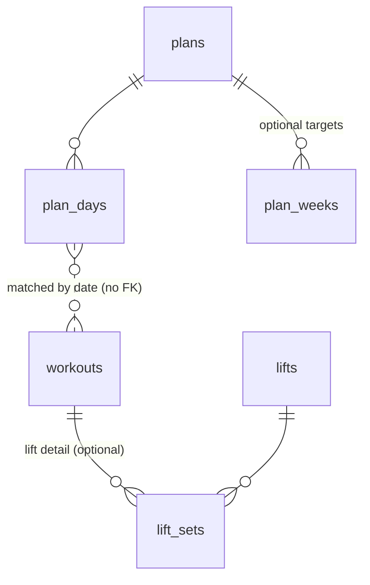

# Training Module: Plan

*Pre-build plan for the **Training** module (`training` schema, `/training` routes). Started 2026-11-02. Like everything in `project_plans/`, it records the reasoning before the build and is **not kept up to date** once code exists. The module's `db/`, `api/` and `ui/` docs take over from there.*

**Start with §9 (Handover)** to pick up where planning stopped.

---

## 1. Why this module exists

Two users, two different needs, one module:

| User | What they want | Uses a plan? |
|---|---|---|
| **The requester** (an early invited user) | Training for the **NYC Marathon** (training starts in 2027). Her plan was a Google Sheet (since lost): one row per week, a week start date, then Monday–Sunday columns holding planned miles. She wants the plan in Disci, logs of what she actually did, plan vs. actual views, dashboards and, most of all, an **AI agent (Instinct) that warns or encourages her** based on how she's doing against the plan. | **Yes**, central |
| **The builder** | A workout history, mainly **lifting**: exercises, weight × reps per set, "what did I lift last time?", and seeing load go up over time. (This was going to be a separate Lifting module.) | **No** |

So the core of the module is **one workout log**. A **plan** is an optional layer on top of it. A user who never makes a plan gets a clean history log, with no empty plan widgets.

Her raw requirements, and the builder's own loose draft of the data model, are in `_LOCAL_SCRATCH/training-module.md` (local, not committed). The requirements are summarized in §4 and the model in §3.

---

## 2. Decisions made

| # | Decision | Why |
|---|---|---|
| D1 | **One module (Training) covers running, walking, biking and lifting.** The planned Lifting module is folded in. | Her lifting entries and the builder's lifting entries are the same kind of thing at different levels of detail. As separate modules, cross-training would never count toward her training week. |
| D2 | **The log doesn't depend on a plan.** Workouts never hold a foreign key to a plan. Plan vs. actual is **computed by date** when it's read (plan days hold miles; they're compared with that date's run, and optionally walk, miles). | The builder uses the log with no plan. Changing or replacing a plan never touches workout history. A workout logged before the plan was imported still counts. |
| D3 | **One month calendar shows planned vs. done** in each day cell, not separate Plan and Actuals tabs. Each week row shows its total against the target band. Tapping a week opens that week's detail. | The comparison is the whole point. With no plan, the same calendar just shows actuals. |
| D4 | **No Lifting tab.** Lifting is one of the activity types in the single "Log workout" flow. Choosing **Lift** shows lift fields, including an optional "add exercises & sets" section. | Builder's preference: one place to log anything. |
| D5 | **Disci doesn't send the daily message.** It serves a **`get_training_brief` MCP tool** with every fact an agent needs (§6). The user's own agent (Instinct, Claude) decides when to send it and what to say. | Matches the standing MCP decision: *scheduled reports belong to the user's AI client* ([mcp-overview.md](../mcp/mcp-overview.md) §6). No new AWS resources, no LLM calls from Disci, no messaging service. |
| D6 | **Disci computes the facts and the rule-based suggestion; the agent writes the words.** For example, Disci says `week_status: "over"` and suggests low-impact options. The agent turns that into "take it easy". | Rules stay testable and the same in the web app and the brief. Tone stays with the agent. |
| D7 | **No new AWS cost expected.** Just new tables in the existing RDS database, new API routes in the existing Lambda, and new MCP tools. | [ops/cost.md](../ops/cost.md) needs no change unless this turns out to be wrong. |

---

## 3. Domain model

Postgres schema `training`. Every table follows [db-overview.md](../db/db-overview.md) §2 (uuid ids, `user_id`, timestamps, soft delete, RLS, composite tenant FKs). All tables and columns below are settled (2026-11-05); only build-time details remain.



### The log (both users)

The builder drafted this part of the model (2026-11-04); the names are theirs. Columns below are the logical model. The `*_id` keys are uuids, and the other standard columns from db-overview §2 (`user_id`, timestamps, soft delete) are added to every table at build time.

**`workouts`**: one row per session.

| Column | Notes |
|---|---|
| `workout_id` | |
| `type` | `run`, `walk`, `bike`, `lift` (CHECK). No `other` type for now. |
| `date` | The day it counts toward, in the user's timezone. (`date` is a SQL type name and `desc` is a reserved word, so both need quoting or a rename at build time.) |
| `location` | **Free text** ("Treadmill", "Hoboken", "Mahwah"). No separate list table. |
| `miles` | Null if `lift`. |
| `time_in_sec` | Optional for every type, `lift` included. Feeds "total time" on the dashboard. |
| `elevation_gain_ft` | Null if `lift`. |
| `avg_heart_rate` | Null if `lift`. |
| `desc` | General description. For a lift it holds the body parts as free text ("back/chest", "legs"). |
| `reflection` | Her free-form reflection on the workout (req 4). The brief reads it (§6). |

Pace is derived (`time_in_sec / miles`) and never stored. Her requirements make time and miles mandatory for runs and walks; whether that's a CHECK or just the form is decided at build time.

**`lifts`**: the user's own catalog of lift types ("Bench Press", "Bicep Curl"). Columns: `lift_id`, `name`, `desc`. Built up as the user logs, like the nutrition food repo.

**`lift_sets`**: optional lift detail, **one row per set**, so sets in the same workout can differ in reps or weight (135×8, 135×8, 135×6, or a pyramid).

| Column | Notes |
|---|---|
| `lift_set_id` | |
| `workout_id` | → `workouts` |
| `lift_id` | → `lifts` |
| `set_number` | 1, 2, 3... counted across the **whole workout**, so it also records which lift came first. |
| `reps` | |
| `weight_num` | **Always pounds.** Null for bodyweight. |

The log form can still take "3 × 8 @ 135" and save it as three rows. "Last time" for a lift is the latest workout's sets for that `lift_id`. Progression (top set, volume = Σ reps × weight, estimated 1RM) is computed from these rows.

### The plan (requester; tentative)

**`plans`**: a user can have **many plans, at most one active** (partial unique index on `user_id` where `is_active`). Old plans stay as history.

| Column | Notes |
|---|---|
| `name` | e.g. "NYC Marathon 2027" |
| `race_name` | |
| `race_on` | Race date, for "days until race". |
| `starts_on` | First day of the plan, for "% of plan to date". |
| `is_active` | |
| `count_walk_miles` | `boolean`, default false. Whether walk miles count toward the plan's mileage (weekly miles, band, % complete). Q5. |
| `cross_train_at_pct` | Number, default 90. Once weekly miles reach this % of the week's target, the suggestion switches from run to cross-train (bike, walk, lift). 90 = the bottom of the band, 100 = the target itself. |

`count_walk_miles` and `cross_train_at_pct` are the first of what will likely be several **plan-level rule settings** (booleans or numbers on `plans` that change how actuals are scored against the plan). The ±10% band width is a candidate to become one later.

**`plan_days`** (decided 2026-11-04): one row per day with **planned miles**. Modeled on her sheet: week start date + Mon–Sun columns, each cell a number of miles.

| Column | Notes |
|---|---|
| `plan_id` | → `plans` |
| `day_on` | Unique per plan. |
| `planned_miles` | **Required, > 0.** A day with no row is a rest day (or simply unplanned; the two are the same). |
| `notes` | Optional ("tempo", "long run"). Only on days with miles, since rest days have no row. |

There is no `kind` column. Today's suggested workout is derived: miles planned → **run**; no row → **rest**; weekly band already reached → **cross-train** (bike, walk, lift; req 7).

**`plan_weeks`** (decided 2026-11-04): `plan_id`, `week_starts_on`, `target_miles`. **Optional, on purpose:** a plan can have daily miles, weekly targets, or both, and a weekly target doesn't have to equal the sum of its days.

- The **weekly target** is the week's `plan_weeks.target_miles` if one is set, otherwise the sum of that week's `planned_miles`. Weeks follow the user's `week_starts_on` from `core.users`.
- **"X of 3 runs"** = run workouts that week vs. the number of `plan_days` rows in the week.
- **Import:** paste the sheet's 8-column block (week start, Mon…Sun). Each non-blank cell becomes a `plan_days` row on week start + 0…6 days.

---

## 4. Requirements → features

Her requirements (numbered as in her list), mapped to what will be built:

| Req | Feature | Needs plan? |
|---|---|---|
| 1, 2 | **Calendar tab**: month view. Each day shows planned miles (and notes) and done (workouts as small activity chips). Each week row shows done / target miles, colored by the band. Tap a week → **week detail**: each day's plan, its workouts and their reflections. | Plan half is hidden without a plan |
| 3, 4 | **Log workout** sheet: pick an activity (Run · Walk · Bike · Lift), then fields for that activity, then the reflection. Lift has the optional exercises & sets section with a "last time: 135 × 8" hint per exercise. Recent locations and lifts are suggested first. | No |
| 5 | **`get_training_brief`** MCP tool (§6), plus a user guide with suggested Instinct instructions. | Mostly |
| 6 | **Dashboard tab**, toggled **This week / Overall**. Weekly: runs X of N, miles against the band, workouts list, status message. Overall: weekly mileage chart (bars + target line), total miles, total time, run count, % of plan complete (progress bar), days to race. | Plan pieces hidden without a plan; totals and charts still work |
| 7 | **Weekly band** = target ± 10%. Inside: green + 🙂 "weekly mileage met". Above: red + "take it easy" warning. Once the week's target is reached: suggest bike, walk or lift instead of another run, "these support your training more than another run will." | Yes |
| (builder) | **Lift history**: per-exercise history and progression, opened from an exercise in the log or the week detail. **Not a tab** (D4). Maybe a "View history" link from the lift fields. | No |

**Navigation (adopted for now, may change): Calendar · History · Dashboard**, plus a **Plan** tab shown only when the user has a plan, and a "Start a plan" entry point on the Calendar (Q8). "History" is a reverse-date list of workouts, filterable by activity. That's the builder's main view, and where edits happen.

**Home card:** with a plan, this week's miles vs. the band plus days to race. Without one, this week's workout count and minutes.

---

## 5. Metrics and rules

These drive the colors, the dashboards and the brief, so they're defined once (in the API) and reused everywhere.

| Metric | Definition | Notes |
|---|---|---|
| Weekly miles | Σ `miles` of **runs** that week, plus **walks** if the plan's `count_walk_miles` is on | |
| Weekly target | `plan_weeks.target_miles` if set, otherwise Σ `planned_miles` of that week's plan days | |
| Band | `[0.9 × target, 1.1 × target]` | |
| Week status | `under` / `in_range` / `over`. For the current week, `under` really means "not there yet" (`on_track` vs. `behind` could compare to the plan so far). Colors: in range **green**, over **red**, under (finished week) **yellow**. | |
| Target reached | Weekly miles ≥ `plans.cross_train_at_pct` % of target (default 90) → start suggesting low-impact cross-training | |
| % of plan complete | **Miles done ÷ total planned miles for the whole plan.** This is the dashboard's progress bar (decided 2026-11-05). "% of plan to date" (done ÷ planned through today) is still returned in the brief, where it's the agent's on-track signal. | |
| Runs completed | Run workouts in the week vs. planned run days. Runs on unplanned days still count. | |
| Days until race | `race_on − today` in the user's timezone | |

---

## 6. The training brief (`get_training_brief`)

One MCP tool call gives an agent everything for a daily message. It is backed by one API endpoint (e.g. `GET /training/brief?on=`), which the web dashboard can reuse. Draft shape:

```jsonc
{
  "date": "2027-07-14",
  "has_plan": true,
  "race": { "name": "NYC Marathon", "date": "2027-11-07", "days_until": 116 },
  "today": { "planned": { "miles": "6.00", "notes": "tempo" }, "done": [] },
  "yesterday": { "planned": {...}, "done": [ /* workouts */ ], "missed_planned_run": false },
  "week": {
    "starts_on": "2027-07-12", "target_miles": "25.00", "band": ["22.50", "27.50"],
    "miles_done": "9.00", "miles_remaining_to_band": "13.50",
    "runs_done": 2, "runs_planned": 4, "status": "under", "pace_vs_plan": "on_track",
    "other_workouts": [ /* bike/walk/lift this week */ ]
  },
  "plan_progress": { "pct_miles_total": "31.2", "pct_miles_to_date": "96.0", "total_miles_done": "142.0", "total_runs": 38 },
  "suggestion": { "type": "run", "reason": "planned", "low_impact_options": [] },
  //  when the target is reached: { "type": "cross_train", "reason": "weekly_target_reached",
  //    "low_impact_options": ["bike", "walk", "lift"] }
  "flags": ["over_band", "missed_planned_run", "streak_3_days", ...],
  "recent_reflections": [ { "date": "2027-07-13", "activity": "run", "miles": "5.00", "text": "..." } ]
}
```

Also, the agent's message should **lead with the motivational part** (her request). That goes in the user guide's suggested agent instructions, not in Disci.

**Other MCP tools:** `log_workout` (including sets), `update_workout`, `delete_workout`, `list_workouts`, `get_training_week`, `get_lift_history` ("what did I bench last time?"). Editing the plan through Claude can wait.

---

## 7. Open questions

**Plan shape (answered 2026-11-04; the sheet was lost, so the builder described its layout):**

- ~~**Q1. Plan granularity.**~~ Daily miles only. `plan_weeks` is kept as an optional override. Day notes are wanted. No planned cross-training.
- ~~**Q1b. Import format.**~~ A grid: week start date + Mon–Sun columns of miles.

**For the requester:**

- ~~**Q2. Locations.**~~ Answered: free text on the workout (§3).
- ~~**Q3. Activities.**~~ Answered: run, walk, bike, lift. No `other` for now.
- ~~**Q4. Body parts.**~~ Answered: free text in the workout's `desc`; no fixed list.
- ~~**Q5. Walk miles.**~~ Answered: a per-plan setting, `plans.count_walk_miles` (§3).
- ~~**Q6. More than one plan.**~~ Answered: many plans, at most one active.
- ~~**Q7. Under the band.**~~ Answered: yellow.

**For the builder:**

- **Q8. Plan management UI home:** going with the proposal for now (a Plan tab shown only when the user has a plan, plus "Start a plan" on the Calendar). The builder may revisit.
- ~~**Q9. Lift detail.**~~ Answered: pounds only, one row per set, no RPE, no per-set notes, no superset labels (the workout-wide `set_number` already keeps order).
- ~~**Q10.**~~ Answered: one `workouts` table with nullable columns by type (§3).
- **Q11. Dashboard without a plan.** As drawn it's run-centric (run miles, weekly run-miles chart). For a lifter with no plan it should probably show workouts and time per week and recent lifts instead. Open (raised 2026-11-05).

---

## 8. Build phases (one PR each)

| Phase | Scope | Unblocks |
|---|---|---|
| **1. Workout log** | Schema (`workouts`, `lifts`, `lift_sets`), API, Log workout sheet (all activities including sets), History tab, simple Calendar (actuals only), MCP log/list tools, module registration and Home card | Both users can start logging. Builder's lifting log is done here. |
| **2. Plan** | `plans`, `plan_days`, `plan_weeks`, grid paste import, plan editing, plan vs. done in the Calendar, week detail, band and status logic | Her core use case |
| **3. Dashboard & brief** | Dashboard tab (weekly + overall, mileage chart), `/training/brief` + `get_training_brief`, user guide with Instinct instructions | Daily messages |
| **4. Lift progression** | Per-exercise history and progression charts, "last time" polish | Builder's load tracking |

Phase 1 doesn't depend on the plan's shape. Lift sets are in Phase 1 because they're part of the single log form (D4); only progression views wait for Phase 4.

---

## 9. Handover (next session starts here)

**State as of 2026-11-02:** planning only, no code. Decisions D1–D7 agreed with the builder. The Google Sheet arrives 2026-11-03. **2026-11-04:** the builder drafted the log's data model (`workouts`, `lifts`, `lift_sets`, now in §3, with their names). It is settled apart from build-time details. Plan tables (`plan_days`, optional `plan_weeks`) were then settled from the builder's description of her lost sheet. **2026-11-05:** `plans` settled (Q5, Q6); Q7 answered; Q8 provisionally adopted; Q9 answered. **The data model is settled and every §7 question is answered or provisionally adopted.** §5's metric definitions are settled too: the "target reached" threshold became a plan setting (`cross_train_at_pct`), and the dashboard's progress bar is % of the whole plan. **Open: Q8 (the builder may revisit) and Q11 (what the Dashboard shows without a plan).**

**Next steps, in order:**

1. ~~Review the requester's Google Sheet.~~ The sheet was lost; Q1 / Q1b were answered from the builder's description (§7).
2. ~~Answer the open questions.~~ Done (§7). Q8 may be revisited.
3. **Clickable mockup** (built 2026-11-02, private Claude artifact owned by the builder): <https://claude.ai/artifact/VWHQs25JVFmRofhERSTTKT>. It has seven phone screens with sample data: Calendar (plan vs. done, tap a week for detail), Log workout (fields change by activity, optional lift sets with "last time"), Dashboard (This week / Overall), History, example daily agent messages, **Start a plan** (name, race, dates, paste the sheet's week rows or type them in, the plan's rules) and the **Plan** tab (rules, week-by-week miles grid with per-week editing of days, notes and an optional weekly target, past plans; added 2026-11-05). A second row shows **the builder's no-plan, lifting-only view**: Calendar (workout counts, no plan), History filtered to lifts with sets, and one lift's history (last time, best set, est. 1RM, sessions). Calendar and Dashboard have a "Has plan" tweak for the log-only view. **Updated 2026-11-05 to the settled data model:** free-text location (with recent values as one-tap fills) and description (body parts for lifts), optional time, plan days as miles + notes only (no row = rest), yellow for a finished week under the band, and the dashboard's progress bar as % of the whole plan.
4. **Write the real module docs** for Phase 1: `docs/db/training.md`, the API section in `docs/api/api-overview.md` §7, `docs/ui/training-ui.md`, and MCP tools in `docs/mcp/mcp-overview.md`. Then build Phase 1.
5. Move this module's line out of the roadmap as each phase lands.

**Existing pieces to reuse:** the catalog pattern from the nutrition food repo (`lifts`), `core.users.week_starts_on` and `timezone` for weeks and days, finance's `subNav` `Alert` (maybe a band-status dot on the Calendar tab), and `shared/ui/module-card.tsx` `Meter` for the Home card.
